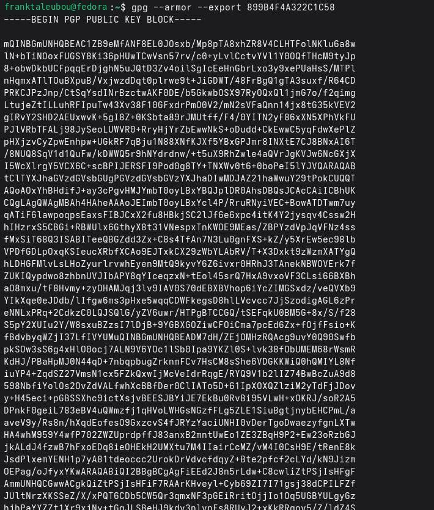
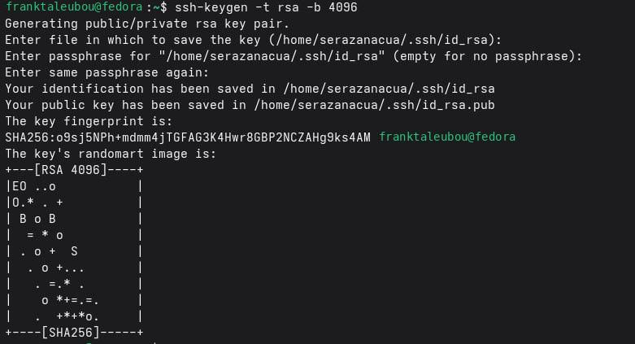
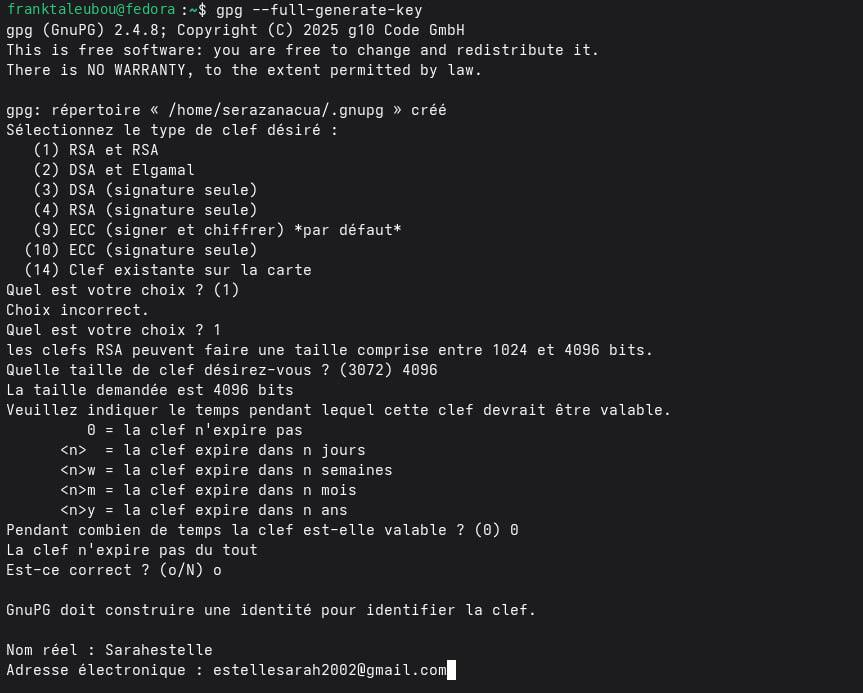
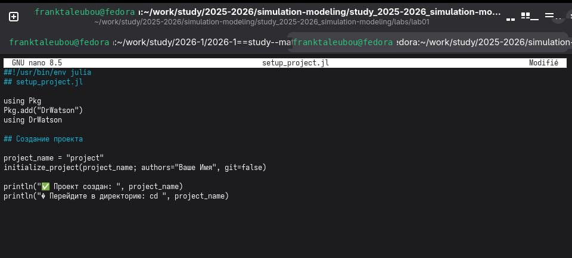
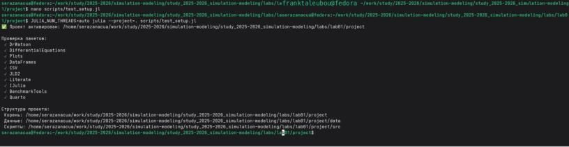
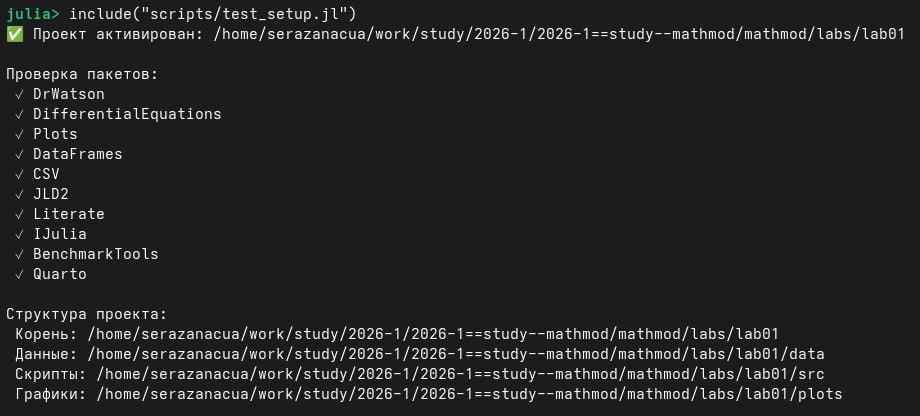
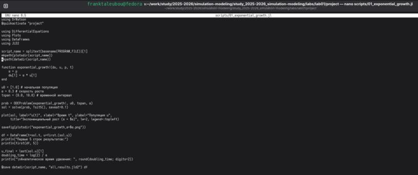
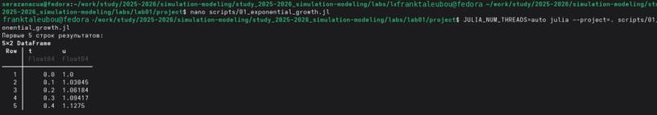

---
## Author
author:
  name: Талебу Тенке Франк
## Title
title: Лабораторная работа № 1
subtitle: Имитационное моделирование
date: today
date-format: "YYYY-MM-DD"
---

# Информация

## Докладчик

- **Талебу Тенке Франк**
- **Студенческий билет:** 1032224534
- Российский университет дружбы народов имени Патриса Лумумбы
- Дисциплина: Имитационное моделирование
- Лабораторная работа № 1

::: notes
Кратко представиться и назвать тему лабораторной работы.
:::

# Вводная часть

## Актуальность

- Вычислительные эксперименты должны быть воспроизводимыми.
- Для этого необходимы контроль версий и единая структура проекта.
- Git, Julia и DrWatson помогают организовать исследовательскую работу.

::: notes
Объяснить, почему важно сохранять код, параметры и результаты экспериментов.
:::

## Объект и предмет исследования

- **Объект:** процесс подготовки вычислительных экспериментов.
- **Предмет:** инструменты Git, Julia, DrWatson и Markdown.

::: notes
Отметить различие между общей организацией экспериментов и конкретными инструментами.
:::

## Цели и задачи

**Цель:** подготовить рабочую среду для имитационного моделирования.

- Настроить Git и ключи доступа.
- Создать репозиторий и проект DrWatson.
- Реализовать модель экспоненциального роста.
- Подготовить воспроизводимую документацию.

::: notes
Перечислить основные этапы выполнения лабораторной работы.
:::

## Материалы и методы

- **Git, GitVerse:** управление версиями.
- **SSH, GPG:** доступ и подпись изменений.
- **Julia, DrWatson:** вычислительные эксперименты.
- **Markdown, Quarto:** подготовка документов.

::: notes
Кратко объяснить назначение каждого инструмента.
:::

# Ход выполнения работы

## Настройка Git

- Заданы имя пользователя и электронная почта.
- Настроены кодировка и параметры репозитория.

{width=70%}

::: notes
Показать основные команды настройки Git.
:::

## Настройка SSH

- Создан RSA-ключ для защищённого доступа.
- Ключ используется при работе с удалёнными репозиториями.

{width=70%}

::: notes
Объяснить назначение SSH-ключа.
:::

## Настройка GPG

- Сгенерирован ключ для подписи изменений.
- Подпись помогает подтверждать происхождение коммитов.

{width=70%}

::: notes
Пояснить различие между доступом по SSH и подписью GPG.
:::

## Подготовка проекта DrWatson

- Подготовлена структура исследовательского проекта.
- Организованы каталоги для исходного кода и результатов.

{width=70%}

::: notes
Объяснить, как DrWatson помогает поддерживать порядок в проекте.
:::

## Реализация модели экспоненциального роста

- Реализована простая вычислительная модель на Julia.
- Подготовлен сценарий её запуска.

{width=70%}

::: notes
Кратко описать, что вычисляет модель.
:::

# Результаты

## Полученные данные

- Выполнен вычислительный эксперимент.
- Получен график экспоненциального роста.

{width=70%}

::: notes
Показать результат и объяснить характер роста.
:::

## Практические результаты

- Код и описание эксперимента объединены в документации.
- Подготовлено создание производных форматов.

{width=70%}

::: notes
Объяснить пользу единого источника для кода и отчёта.
:::

## Итоговые материалы

- Подготовлен скрипт генерации файлов проекта.
- Автоматизация упрощает повторное получение результатов.

{width=70%}

::: notes
Показать итоговый этап автоматизации.
:::

# Заключение

## Главный вывод

- Настроены инструменты Git, SSH и GPG.
- Создан проект для моделирования на Julia с DrWatson.
- Реализована модель экспоненциального роста.
- Освоены основы воспроизводимой документации.

::: notes
Подвести итог и отметить, что подготовленная среда пригодится в следующих лабораторных работах.
:::
