**Студент:** Талебу Тенке Франк  
**Студенческий номер:** 1032224534  
**Лабораторная работа № 1:** Имитационное моделирование

\newpage
# Введение

## Актуальность

Работа посвящена подготовке программной среды и освоению методологии современной программной инженерии для проведения научных исследований. Воспроизводимые вычислительные эксперименты требуют владения языками программирования и инструментами управления проектами.

\newpage

## Цель работы

Подготовить рабочую среду для лабораторных работ по имитационному моделированию и освоить инструменты, необходимые для создания воспроизводимых вычислительных экспериментов.
\newpage

## Задачи

1. Ознакомиться с принципами программной инженерии и использованием Git.
2. Изучить литературное программирование, Markdown и соглашение об именовании Denote.
3. Настроить Git и создать ключи SSH и PGP.
4. Подготовить репозиторий и рабочее пространство курса.
5. Создать проект DrWatson и установить необходимые пакеты Julia.
6. Реализовать и запустить модель экспоненциального роста.
7. Подготовить производные форматы проекта.

\newpage

# Теоретическая часть

Для организации воспроизводимых экспериментов используются система контроля версий Git, язык Julia, пакет DrWatson и текстовая разметка Markdown. Git позволяет сохранять историю изменений, а DrWatson помогает организовать структуру вычислительного проекта. Литературное программирование объединяет программный код с пояснениями и результатами.

\newpage

# Материалы и методы

В ходе работы использовались терминал, Git, инструменты создания ключей SSH и PGP, репозиторий курса, язык Julia и пакет DrWatson. Этапы выполнения зафиксированы в снимках экрана.

\newpage

# Выполнение лабораторной работы

\newpage

## Настройка Git

Настроены имя и адрес электронной почты владельца репозитория, кодировка сообщений Git, имя начальной ветки и параметры обработки окончаний строк.

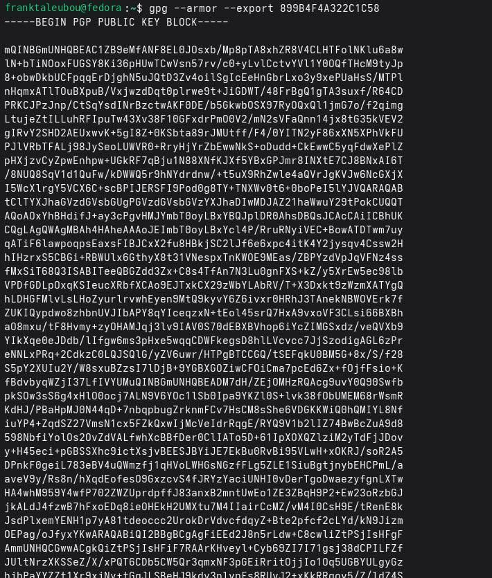{width=75% fig-pos="H"}

\newpage

## Создание ключей SSH и PGP

Созданы SSH-ключи с алгоритмами RSA (4096 бит) и Ed25519. Затем выполнена генерация PGP-ключа.

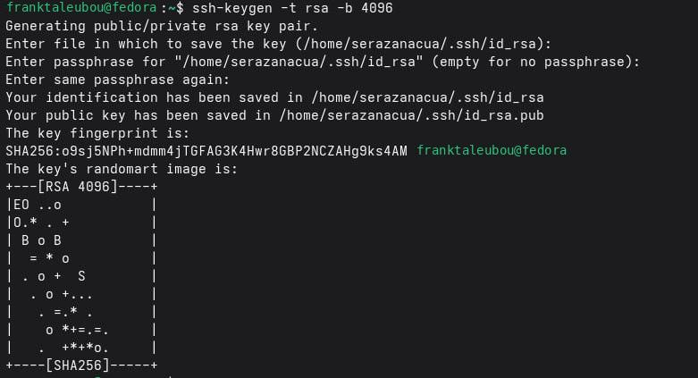{width=75% fig-pos="H"}

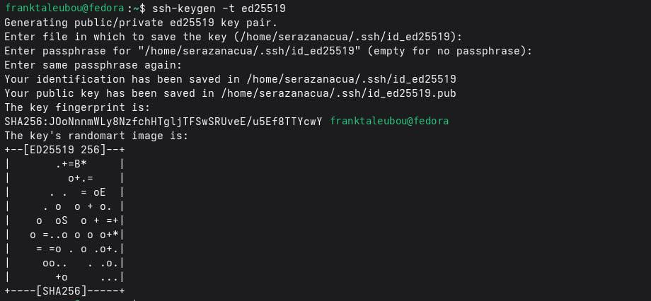{width=75% fig-pos="H"}

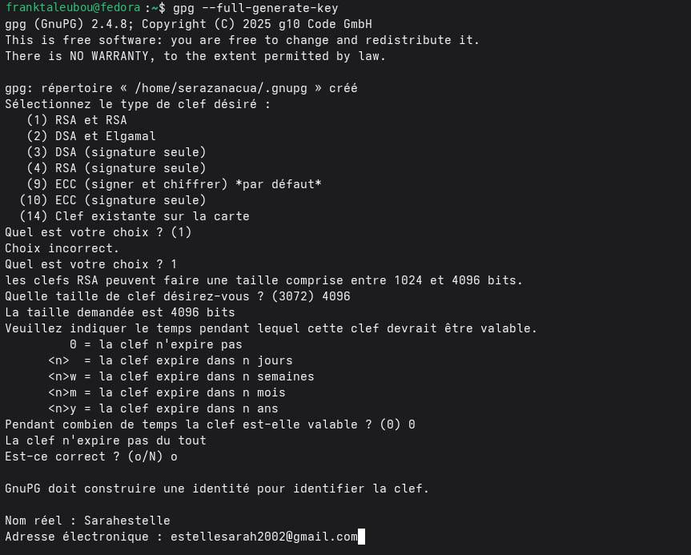{width=75% fig-pos="H"}

\newpage

## Добавление PGP-ключа на хостинг

Получен отпечаток ключа, выполнен экспорт публичного PGP-ключа и настроено использование ключа для подписи коммитов Git.

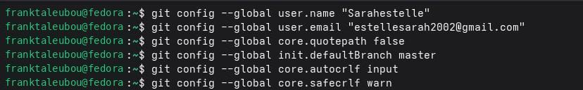{width=75% fig-pos="H"}

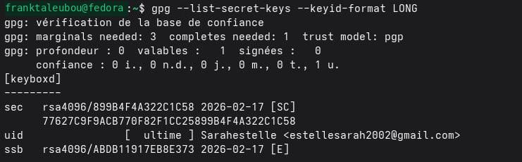{width=75% fig-pos="H"}

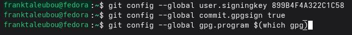{width=75% fig-pos="H"}

\newpage

## Создание репозитория курса на основе шаблона

Создан репозиторий курса с использованием шаблона на GitVerse.

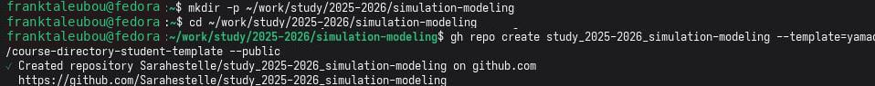{width=75% fig-pos="H"}

\newpage

## Настройка каталога курса

Подготовлен каталог курса, выполнена инициализация и отправка файлов в удалённый репозиторий.

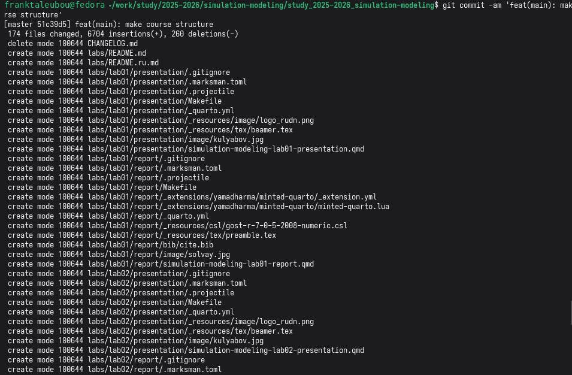{width=75% fig-pos="H"}

\newpage

## Создание проекта DrWatson для лабораторных работ

Создан проект DrWatson и проверен запуск рабочего окружения.

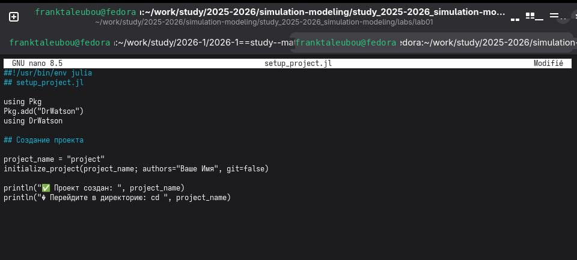{width=75% fig-pos="H"}

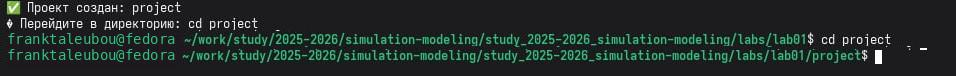{width=75% fig-pos="H"}

\newpage

## Добавление необходимых пакетов

Подготовлен скрипт установки пакетов, создан файл `add_packages.jl`, проверена установка и запущен тестовый скрипт `scripts/test_setup.jl`.

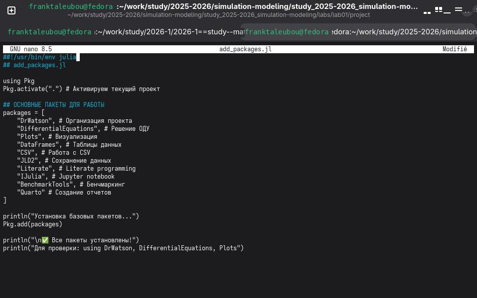{width=75% fig-pos="H"}

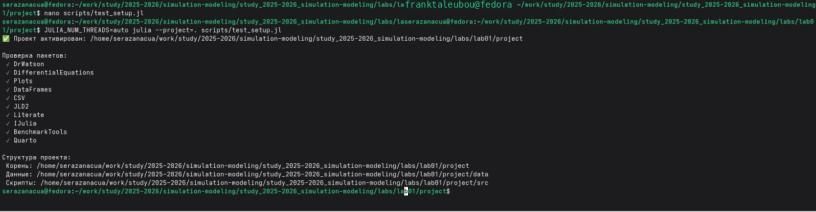{width=75% fig-pos="H"}

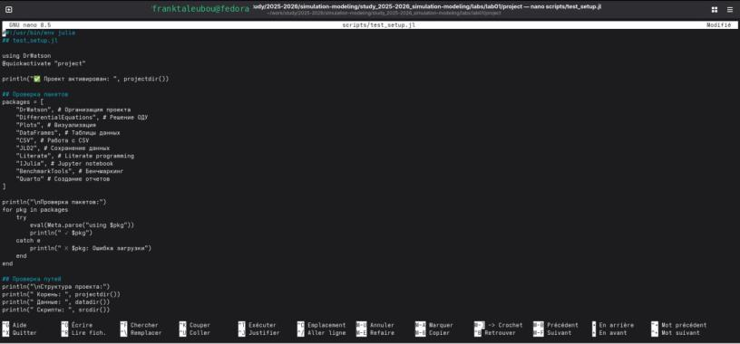{width=75% fig-pos="H"}

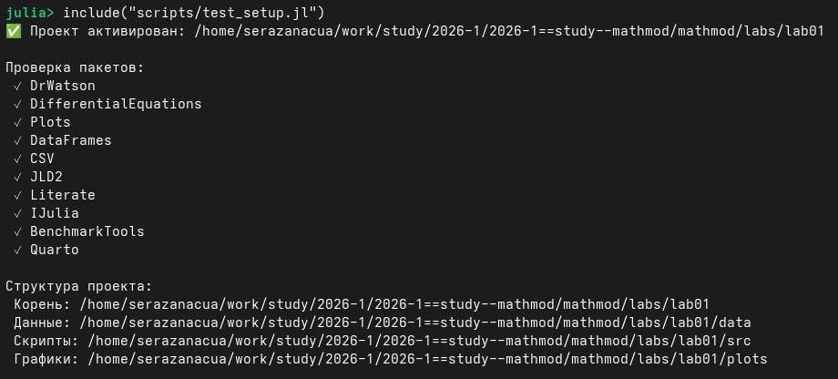{width=75% fig-pos="H"}

\newpage

## Модель экспоненциального роста

Реализована модель экспоненциального роста на Julia. Создан и запущен скрипт `scripts/01_exponential_growth.jl`; получен график зависимости популяции от времени.

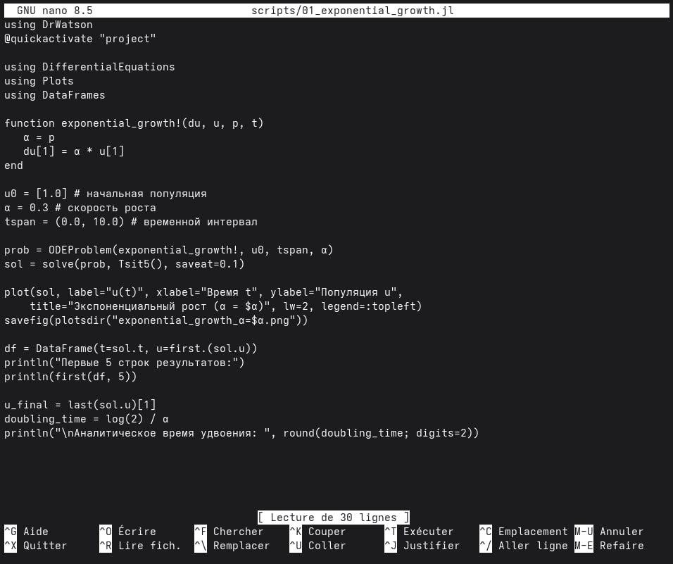{width=75% fig-pos="H"}

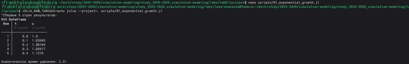{width=75% fig-pos="H"}

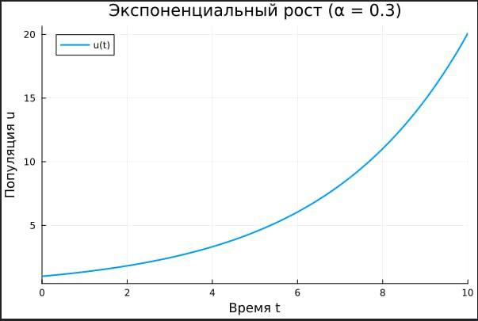{width=75% fig-pos="H"}

\newpage

## Литературная реализация модели

Подготовлена литературная реализация модели, объединяющая программный код и результаты его выполнения.

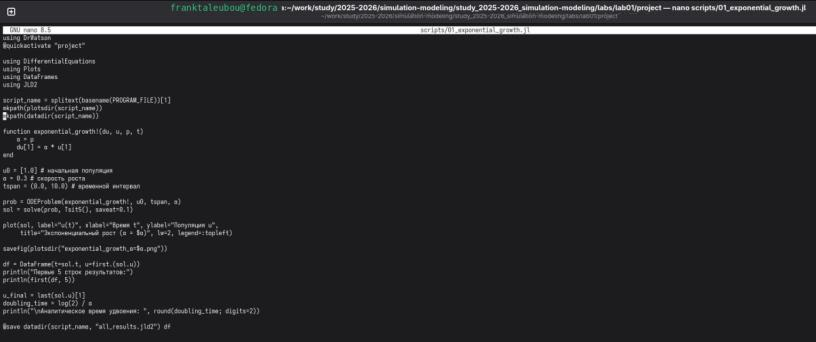{width=75% fig-pos="H"}

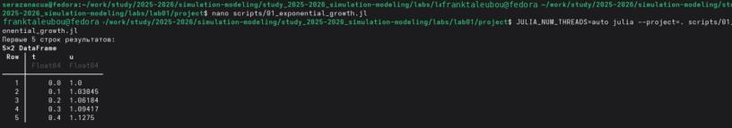{width=75% fig-pos="H"}

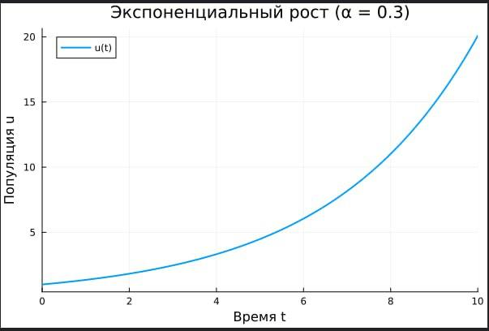{width=75% fig-pos="H"}

\newpage

## Создание производных форматов

Подготовлены производные форматы и скрипт `scripts/tangle.jl` для их генерации.

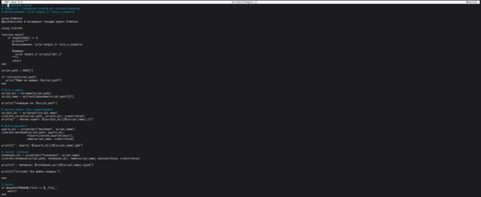{width=75% fig-pos="H"}

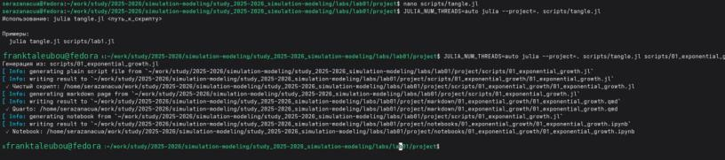{width=75% fig-pos="H"}

\newpage

# Результаты

В ходе лабораторной работы настроены инструменты управления версиями и подписи коммитов, создан репозиторий курса, подготовлен проект DrWatson, проверена работа необходимых пакетов Julia и построен график модели экспоненциального роста. Выполнена подготовка производных форматов.

\newpage

# Обсуждение результатов

Подготовленная структура проекта объединяет исходный код, результаты вычислений и документацию. Это создаёт основу для дальнейшего проведения воспроизводимых экспериментов и ведения лабораторных работ.

\newpage

# Заключение

В результате лабораторной работы подготовлен программный стенд для курса имитационного моделирования. Освоены базовые операции с Git, SSH и PGP, создан проект DrWatson, проверена среда Julia и выполнен пример модели экспоненциального роста.

\newpage

# Список литературы {.unnumbered}

1. Материалы лабораторной работы № 1 «Имитационное моделирование» (предоставленный отчёт).
2. Документация Julia и DrWatson (использованные программные средства).

