---
## Author
author:
  name: Талебу Тенке Франк
## Title
title: Лабораторная работа № 2
subtitle: Модели SIR и Лотки–Вольтерры
date: today
date-format: "YYYY-MM-DD"
---

# Информация

## Докладчик

- **Талебу Тенке Франк**
- **Студенческий билет:** 1032224534
- Российский университет дружбы народов имени Патриса Лумумбы
- Дисциплина: Имитационное моделирование
- Лабораторная работа № 2

::: notes
Представиться и назвать тему: моделирование SIR и системы Лотки–Вольтерры.
:::

# Вводная часть

## Актуальность

- Математические модели помогают исследовать динамику сложных систем.
- Модель SIR описывает распространение инфекции в популяции.
- Модель Лотки–Вольтерры применяется для изучения взаимодействия популяций.

::: notes
Объяснить, зачем моделировать изменение численности групп во времени.
:::

## Объект и предмет исследования

- **Объект:** динамические процессы в популяциях.
- **Предмет:** численное моделирование систем SIR и Лотки–Вольтерры на Julia.

::: notes
Кратко пояснить различие между исследуемыми процессами и моделями, которыми они описываются.
:::

## Цели и задачи

**Цель:** реализовать и исследовать модели SIR и Лотки–Вольтерры.

- Подготовить рабочий каталог и необходимые пакеты Julia.
- Запустить модель SIR и изучить её параметры.
- Запустить модель Лотки–Вольтерры.
- Проанализировать полученные графики.

::: notes
Перечислить четыре основных этапа лабораторной работы.
:::

## Материалы и методы

- **Julia:** реализация и запуск вычислительных моделей.
- **SIR:** группы восприимчивых, инфицированных и выздоровевших.
- **Лотка–Вольтерра:** модель взаимодействия популяций.
- **Графики:** визуальный анализ результатов моделирования.

::: notes
Уточнить, что результаты оцениваются по изменению величин во времени.
:::

# Ход выполнения работы

## выполнение 

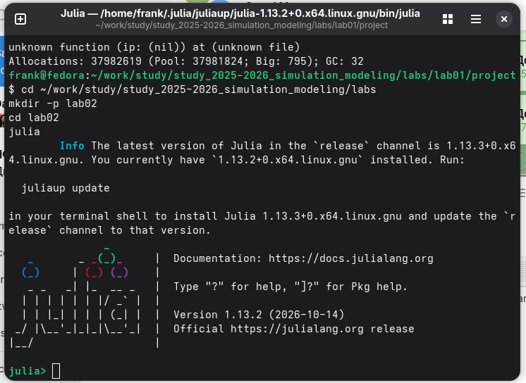{width=70%}

## выполнение 

{width=70%}

## выполнение 

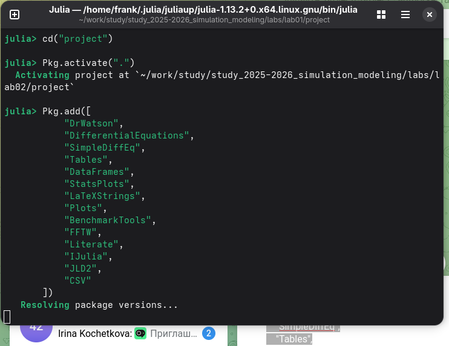{width=70%}

## выполнение 

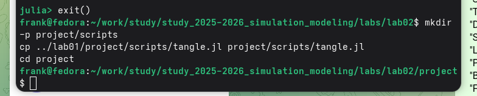{width=70%}

## выполнение 

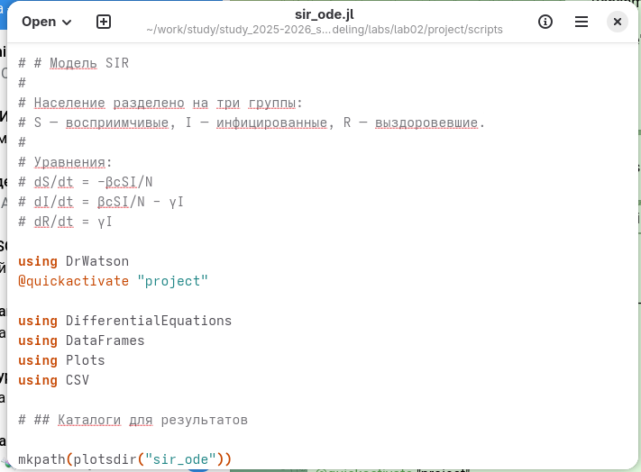{width=70%}

## выполнение 

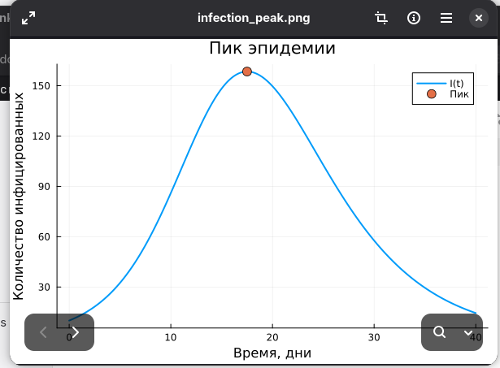{width=70%}

## выполнение 

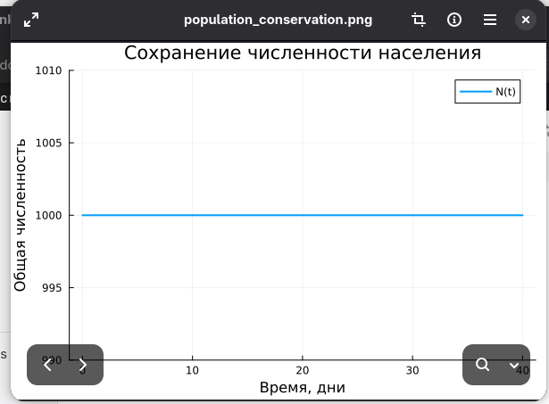{width=70%}

## выполнение 

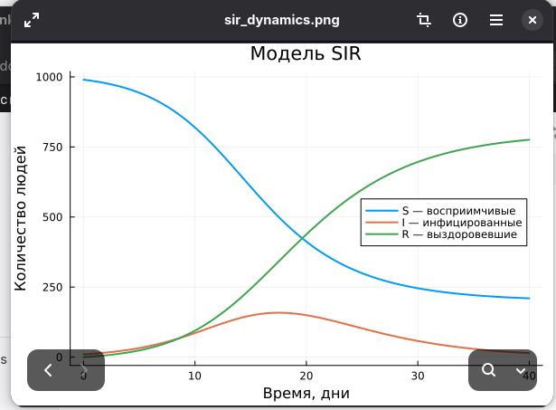{width=70%}

## выполнение 

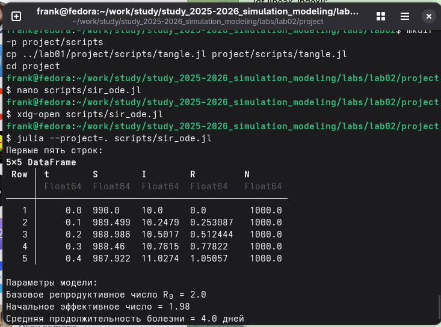{width=70%}

## выполнение 

{width=70%}

## выполнение 

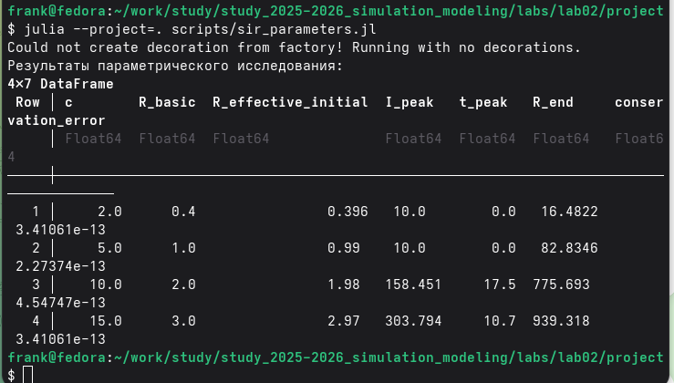{width=70%}

## выполнение 

{width=70%}

## выполнение 

{width=70%}

## выполнение 

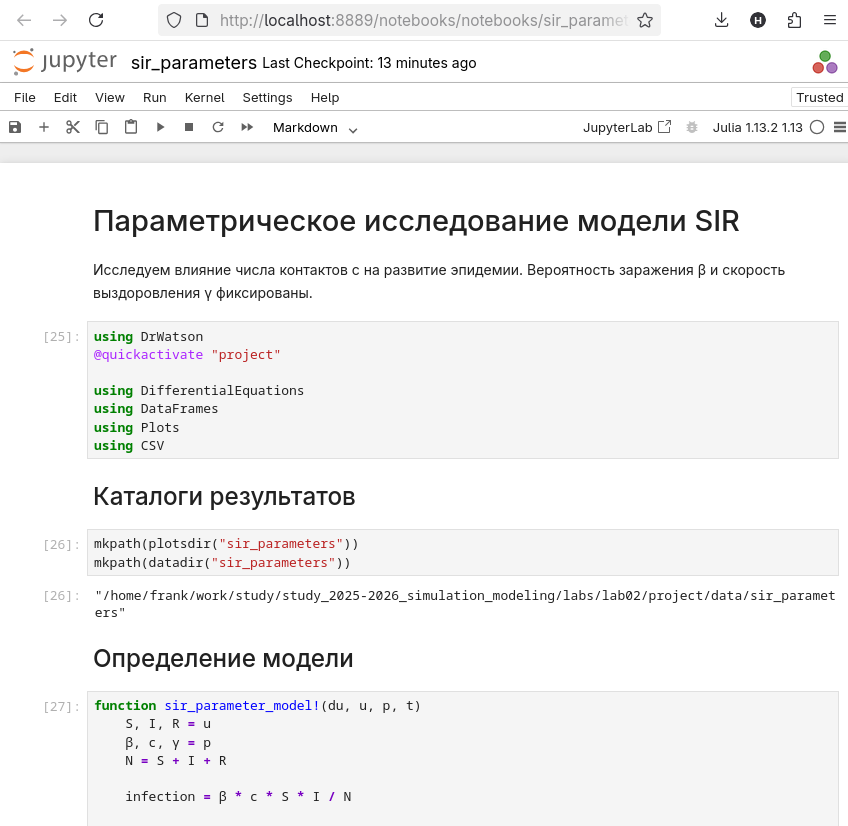{width=70%}

## выполнение 

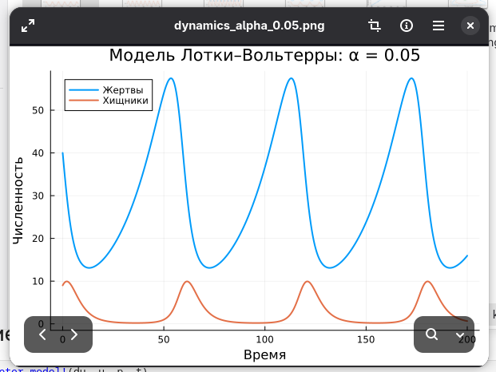{width=70%}

## выполнение 

{width=70%}

# Заключение

## Главный вывод

- Подготовлена среда моделирования на Julia.
- Реализованы и запущены модели SIR и Лотки–Вольтерры.
- Построены и рассмотрены графики результатов.
- Закреплены навыки исследования динамических моделей.

::: notes
Подвести итог работы и подчеркнуть практическую роль компьютерного моделирования.
:::
