**Студент:** Талебу Тенке Франк  
**Студенческий номер:** 1032224534  
**Лабораторная работа № 2:** Модели SIR и Лотки–Вольтерры

\newpage

# Введение

Работа посвящена математическому моделированию динамических процессов: распространению инфекции в популяции и взаимодействию хищников и жертв.

\newpage

## Актуальность

Модели на основе дифференциальных уравнений позволяют исследовать развитие эпидемий и изменения численности взаимодействующих популяций во времени.

\newpage

## Цель работы

Изучить модели SIR и Лотки–Вольтерры, выполнить их численное моделирование в Julia и проанализировать результаты с помощью графиков.

\newpage

## Задачи

1. Подготовить рабочий каталог и установить необходимые пакеты Julia.
2. Запустить программы `sir_ode.jl` и `lv_ode.jl`.
3. Построить и проанализировать графики модели SIR.
4. Построить и проанализировать графики модели Лотки–Вольтерры.

\newpage

# Теоретическая часть

Модель SIR разделяет популяцию на восприимчивых $S$, инфицированных $I$ и выздоровевших $R$. Для замкнутой популяции используется система:

$$
\frac{dS}{dt}=-\beta c\frac{SI}{N},\qquad
\frac{dI}{dt}=\beta c\frac{SI}{N}-\gamma I,\qquad
\frac{dR}{dt}=\gamma I.
$$

Базовое репродуктивное число: $R_0=\frac{\beta c}{\gamma}$.

Модель Лотки–Вольтерры описывает взаимодействие популяций жертв $x$ и хищников $y$:

$$
\frac{dx}{dt}=\alpha x-\beta xy,\qquad
\frac{dy}{dt}=\delta xy-\gamma y.
$$

Параметры определяют рост жертв, интенсивность поедания, эффективность преобразования пищи и смертность хищников.

\newpage

# Материалы и методы

Использованы язык Julia, численное решение обыкновенных дифференциальных уравнений и построение графиков. Основные программы — `sir_ode.jl` и `lv_ode.jl`. Результаты представлены на снимках экрана.

\newpage

# Выполнение лабораторной работы

Выполнение разделено на подготовку среды, реализацию модели SIR и реализацию модели Лотки–Вольтерры.

\newpage

## Подготовка среды и запуск моделей

\newpage

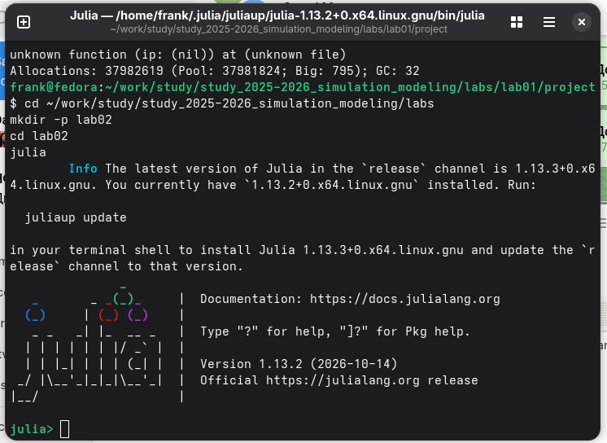{width=75% fig-pos="H"}
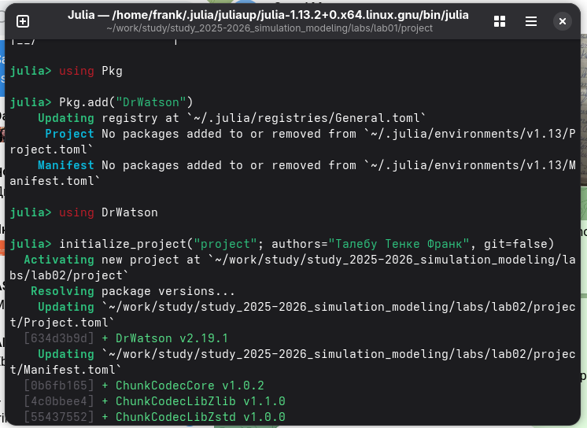{width=75% fig-pos="H"}

\newpage

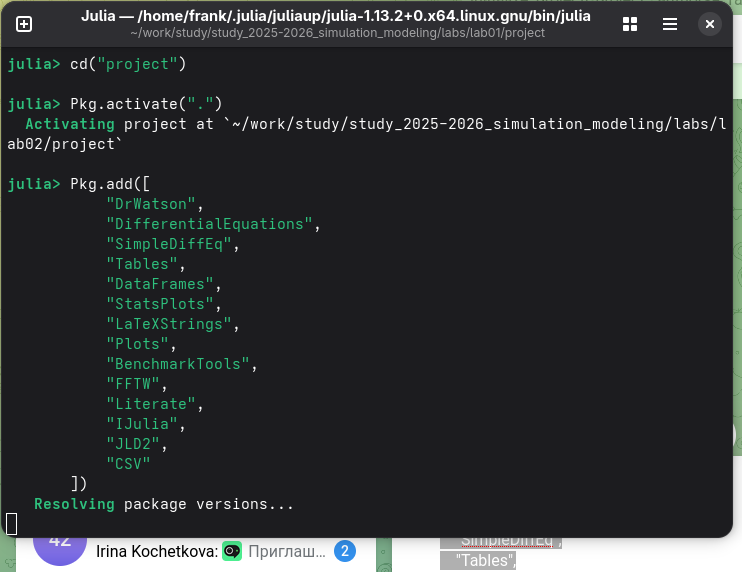{width=75% fig-pos="H"}

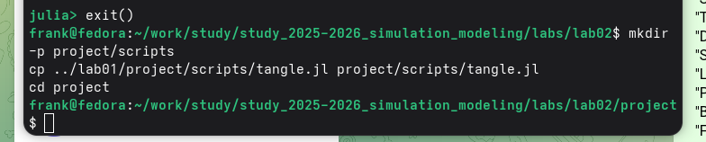{width=75% fig-pos="H"}

\newpage

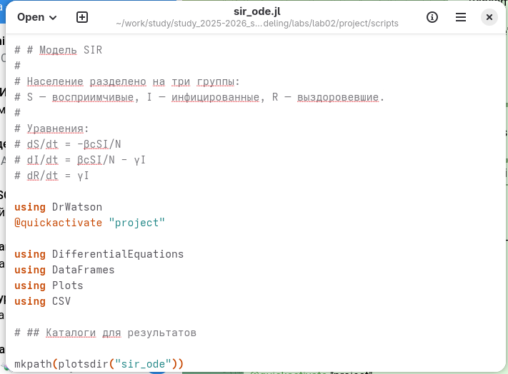{width=75% fig-pos="H"}

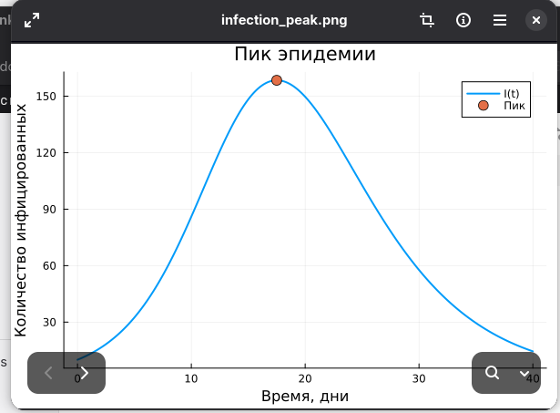{width=75% fig-pos="H"}

\newpage

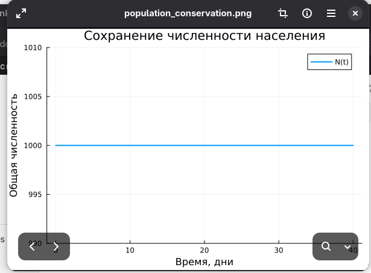{width=75% fig-pos="H"}

\newpage

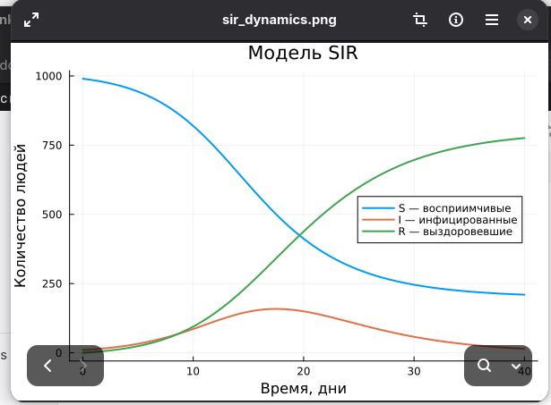{width=75% fig-pos="H"}

\newpage

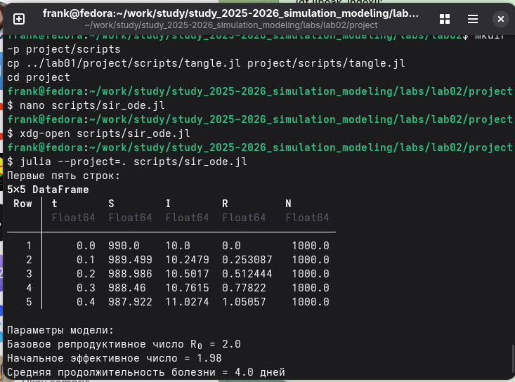{width=75% fig-pos="H"}

\newpage

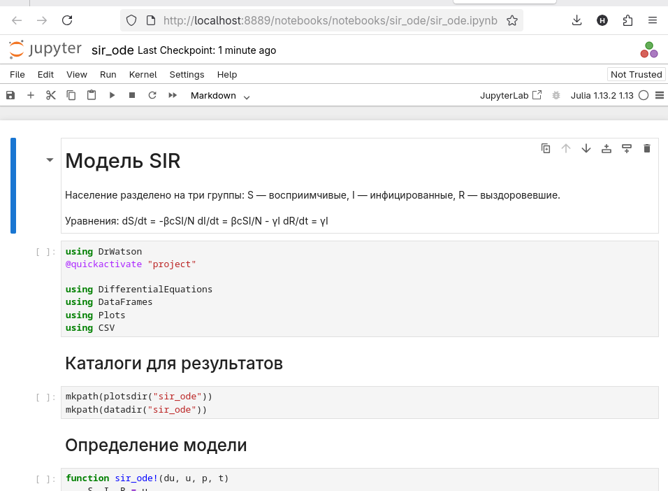{width=75% fig-pos="H"}

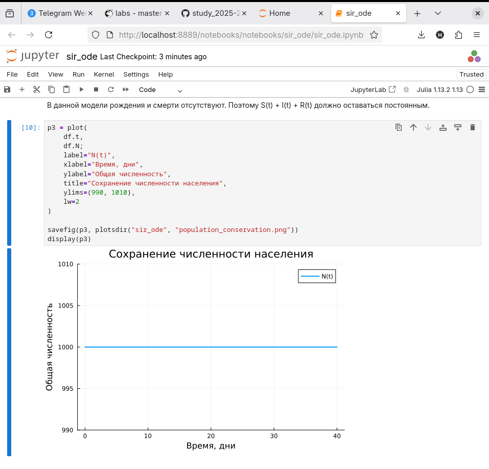{width=75% fig-pos="H"}

\newpage

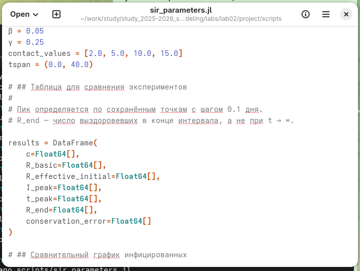{width=75% fig-pos="H"}

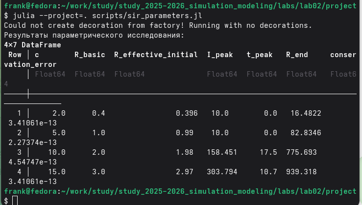{width=75% fig-pos="H"}

\newpage

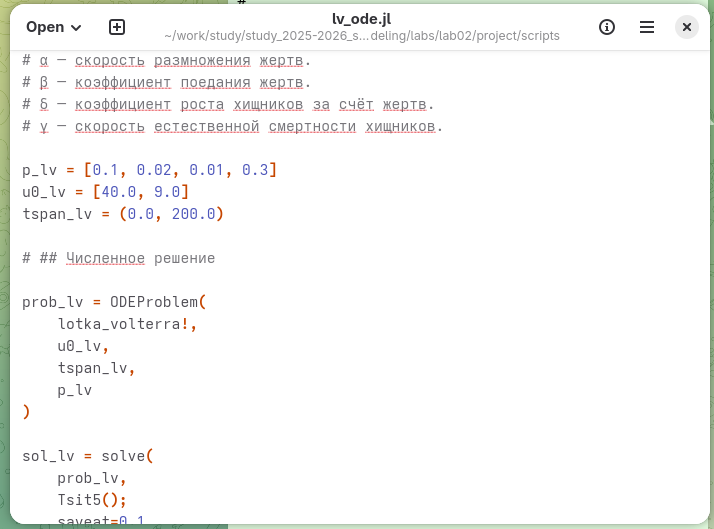{width=75% fig-pos="H"}

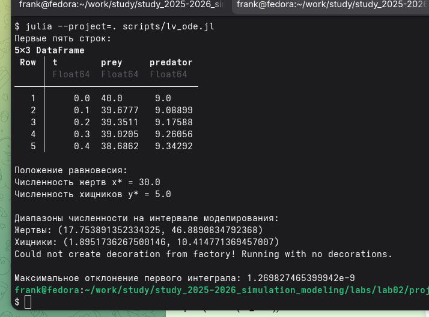{width=75% fig-pos="H"}

\newpage

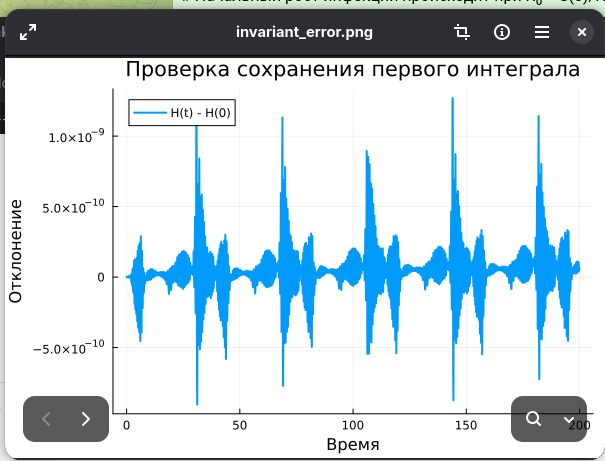{width=75% fig-pos="H"}

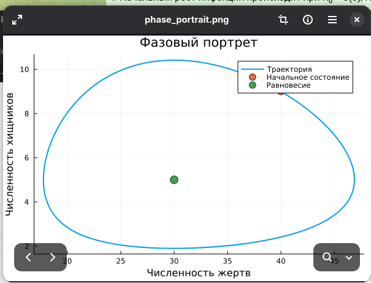{width=75% fig-pos="H"}

\newpage

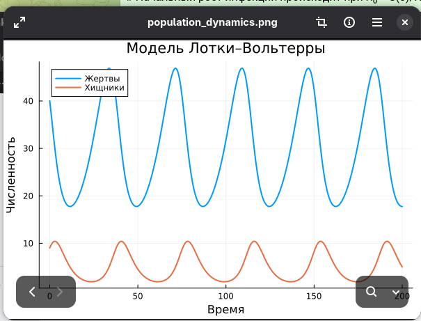{width=75% fig-pos="H"}

\newpage

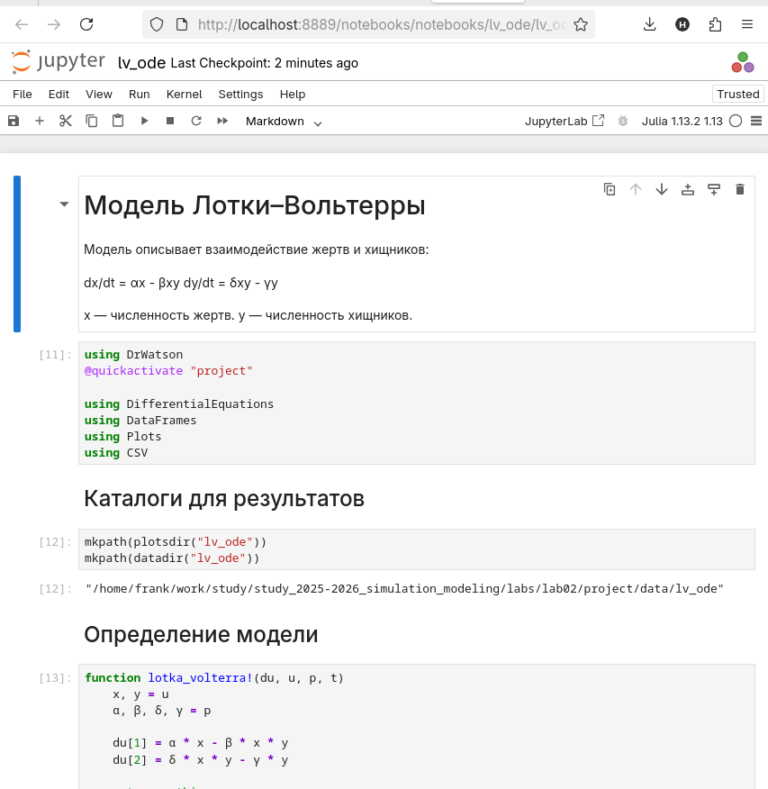{width=75% fig-pos="H"}

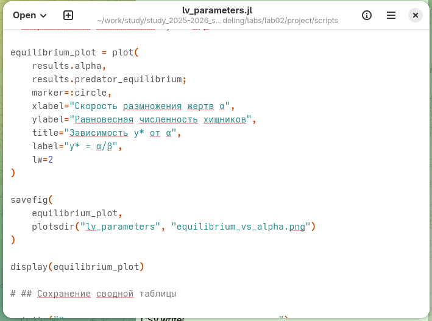{width=75% fig-pos="H"}

\newpage

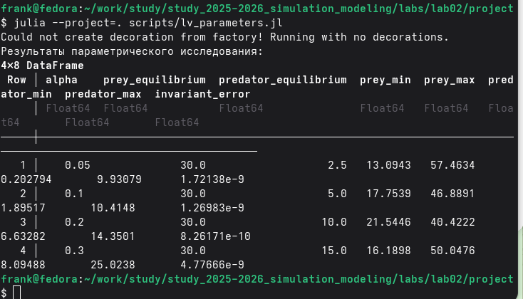{width=75% fig-pos="H"}

\newpage

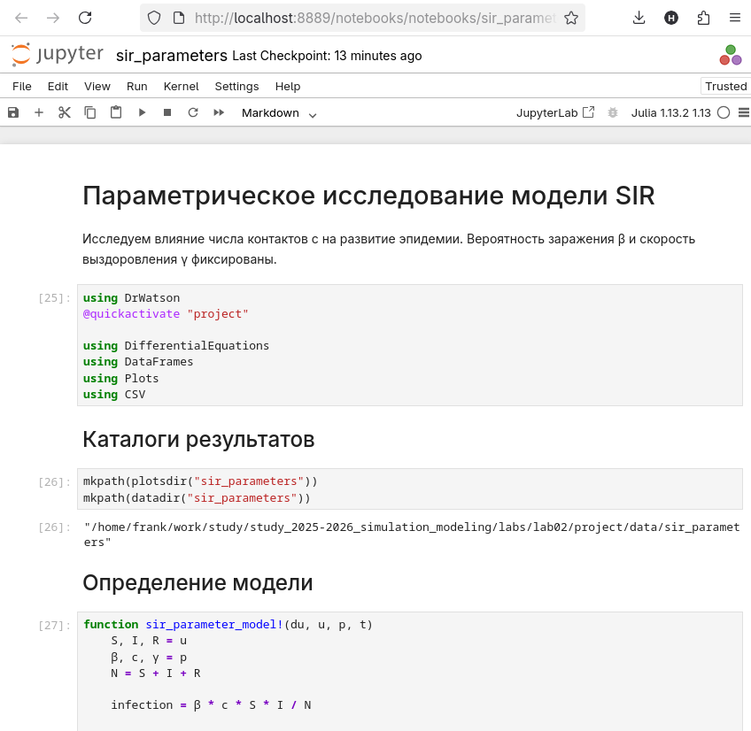{width=75% fig-pos="H"}

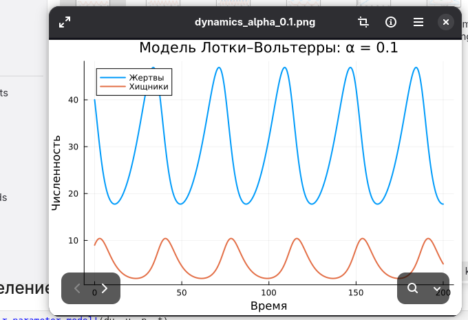{width=75% fig-pos="H"}

\newpage

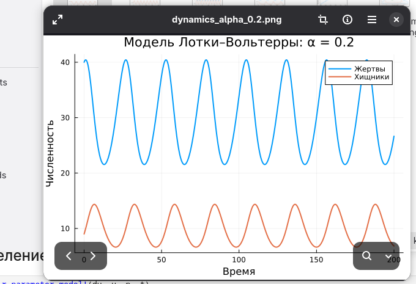{width=75% fig-pos="H"}

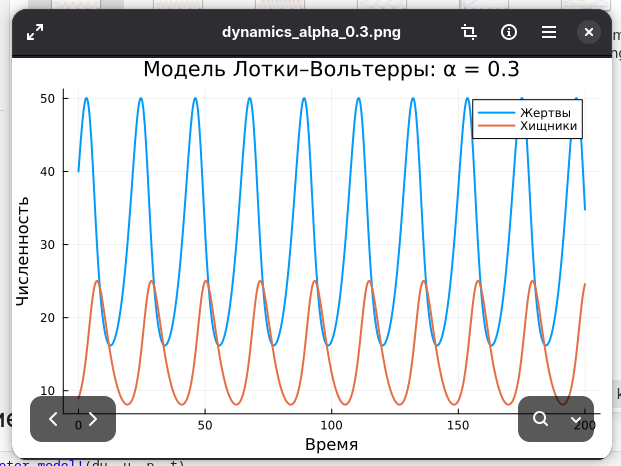{width=75% fig-pos="H"}

\newpage
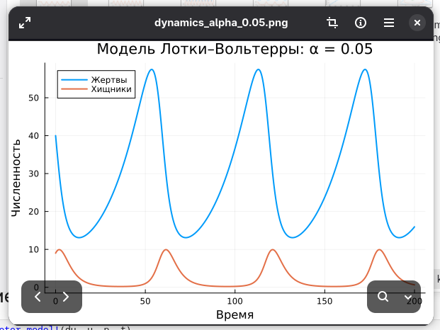{width=75% fig-pos="H"}

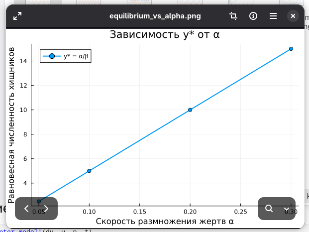{width=75% fig-pos="H"}

\newpage

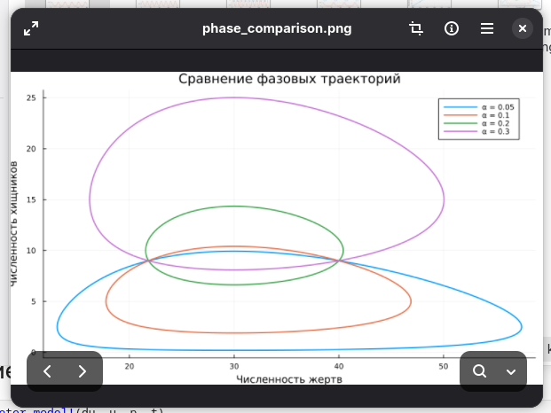{width=75% fig-pos="H"}

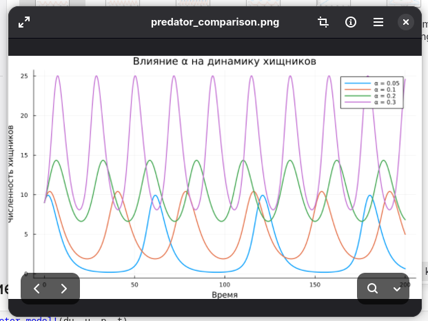{width=75% fig-pos="H"}

\newpage

\newpage

# Результаты

Запущены модели SIR и Лотки–Вольтерры. Для SIR получены графики динамики групп, инфицирования, фазовый портрет и оценка эффективного репродуктивного числа. Для модели Лотки–Вольтерры получены временные зависимости, фазовый портрет, производные, относительные темпы роста, спектральный анализ и сводные графики.

\newpage

# Обсуждение результатов

Результаты модели SIR позволяют проследить изменение численности восприимчивых, инфицированных и выздоровевших. В модели Лотки–Вольтерры графики иллюстрируют колебательную динамику численности жертв и хищников. Фазовые портреты показывают взаимосвязь переменных.

\newpage

# Заключение

Выполнена лабораторная работа № 2. Проведено моделирование двух систем дифференциальных уравнений в Julia и подготовлены графики для анализа динамики эпидемии и взаимодействия популяций.

\newpage

# Список литературы {.unnumbered}

1. Материалы лабораторной работы № 2 «Модели SIR и Лотки–Вольтерры» (предоставленный отчёт).
