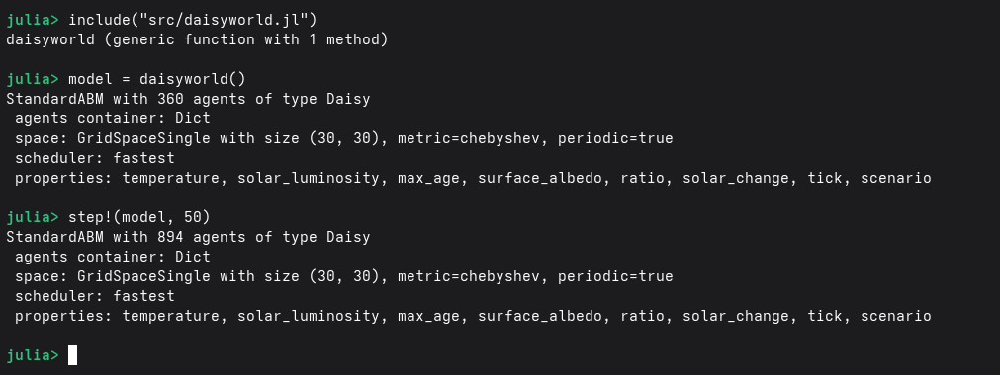
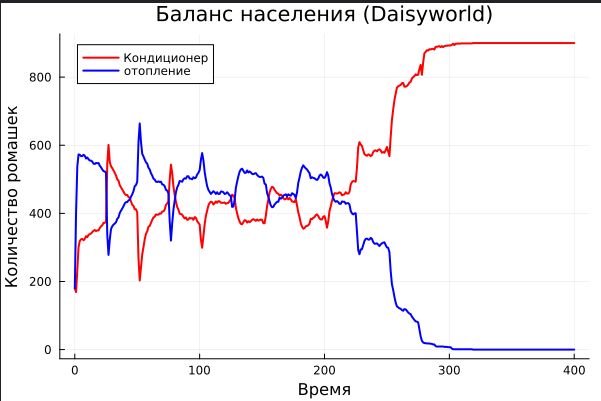
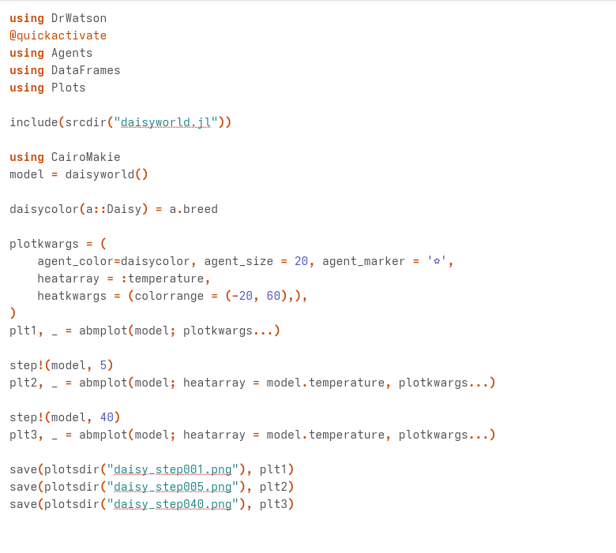
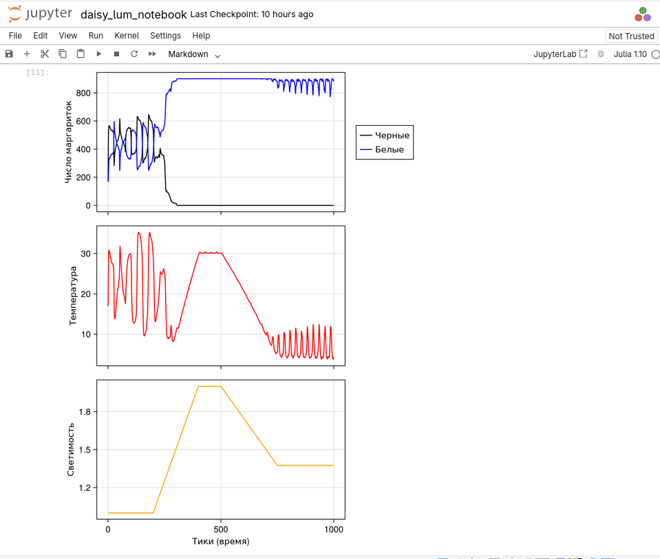
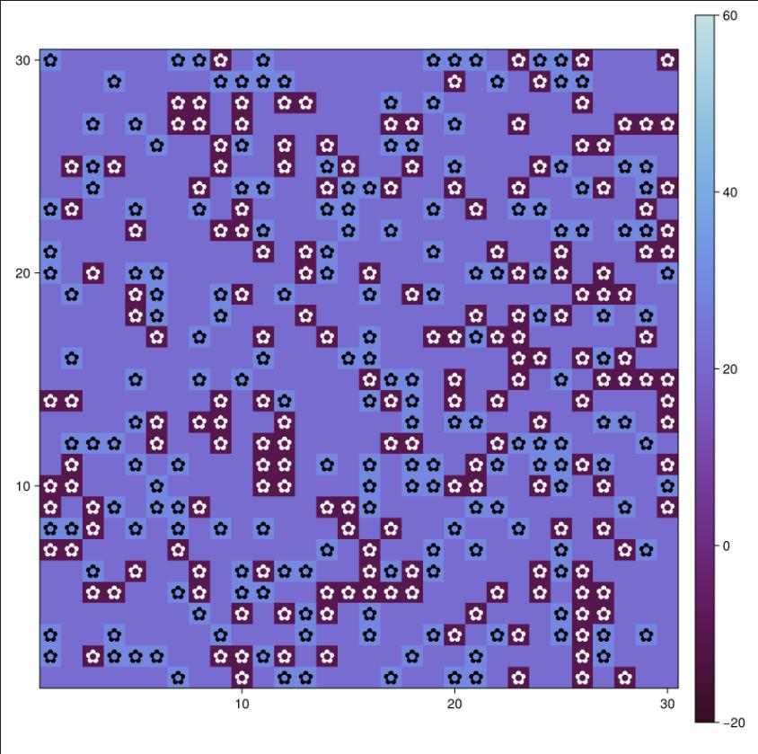
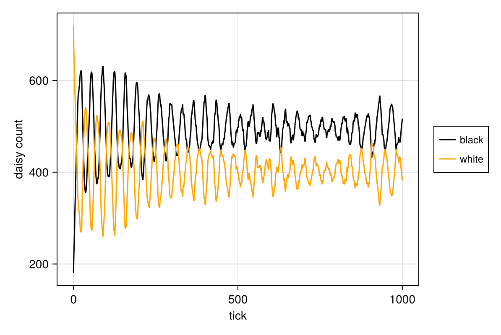
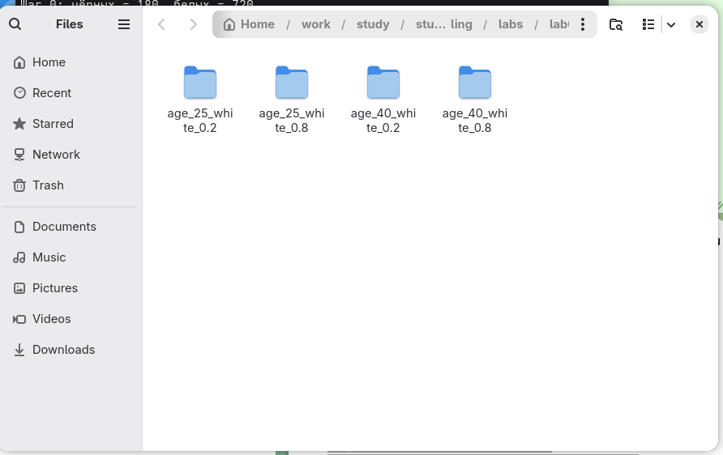

---
## Author
author:
  name: Талебу Тенке Франк
## Title
title: Лабораторная работа № 3
subtitle: Агентное моделирование
date: today
date-format: "YYYY-MM-DD"
---

# Информация

## Докладчик

- **Талебу Тенке Франк**
- **Студенческий билет:** 1032224534
- Российский университет дружбы народов имени Патриса Лумумбы
- Дисциплина: Имитационное моделирование
- Лабораторная работа № 3

::: notes
Представиться и назвать тему лабораторной работы: агентное моделирование.
:::

# Вводная часть

## Актуальность

- Агентное моделирование изучает сложные системы через взаимодействие отдельных агентов.
- Коллективное поведение возникает из локальных правил.
- Модель Daisyworld позволяет исследовать связь популяций и температуры среды.

::: notes
Объяснить, что агентный подход позволяет наблюдать общую динамику на основе поведения отдельных элементов.
:::

## Объект и предмет исследования

- **Объект:** искусственная экосистема «Мир маргариток» (Daisyworld).
- **Предмет:** влияние поведения агентов и параметров среды на численность популяций и температуру.

::: notes
В модели рассматриваются чёрные и белые маргаритки, взаимодействующие с окружающей средой.
:::

## Цели и задачи

**Цель:** освоить агентный подход на примере Daisyworld.

- Реализовать модель на Julia с использованием Agents.jl.
- Построить визуализации и графики динамики.
- Подготовить код и документацию в литературном стиле.
- Исследовать влияние параметров модели.

::: notes
Кратко перечислить этапы лабораторной работы.
:::

## Материалы и методы

- **Julia, Agents.jl:** реализация агентов и правил взаимодействия.
- **Daisyworld:** модель взаимодействия маргариток и температуры.
- **Jupyter Notebook:** запуск и анализ вычислений.
- **Quarto:** воспроизводимая документация и отчёт.

::: notes
Объяснить назначение инструментов, использованных в работе.
:::

# Ход выполнения работы

## Реализация модели на Agents.jl

- Создан файл `src/daisyworld.jl`.
- Определены агенты и функции изменения состояния модели.

{width=70%}

::: notes
Показать начало реализации модели и основные компоненты кода.
:::

## Первые результаты моделирования

- Выполнен запуск модели.
- Получены результаты изменения численности агентов.

{width=70%}

::: notes
Пояснить, какие данные показывает первый график популяций.
:::

## Базовая визуализация Daisyworld

- Построена визуализация распределения агентов.
- Цвет маргариток влияет на поглощение и отражение тепла.

{width=70%}

::: notes
Объяснить различие между чёрными и белыми маргаритками.
:::

## Динамика числа маргариток

- Построен график изменения популяций во времени.
- По графику можно сравнить динамику двух типов агентов.

{width=70%}

::: notes
Обратить внимание на изменения численности популяций в ходе эксперимента.
:::

## Комплексная динамика модели

- Исследованы численность маргариток, температура и альбедо.
- Сопоставлены изменения характеристик экосистемы.

{width=70%}

::: notes
Показать, как параметры среды связаны с состоянием популяций.
:::

# Результаты

## Исследование параметров

- Добавлены варьируемые параметры, включая `max_age` и `init_white`.
- Подготовлена серия вычислительных экспериментов.

{width=70%}

::: notes
Объяснить, зачем изменять начальные параметры и сравнивать несколько запусков.
:::

## Сравнение результатов экспериментов

- Получены визуализации при различных параметрах.
- Исследовано влияние начальных условий на развитие популяций.

{width=70%}

::: notes
Показать один из результатов моделирования с изменёнными параметрами.
:::

## Итоговая динамика при разных параметрах

- Построены комплексные графики динамики экосистемы.
- Сравнены изменения популяций, температуры и альбедо.

{width=70%}

::: notes
Подвести итог серии экспериментов и отметить зависимость поведения модели от параметров.
:::

# Заключение

## Главный вывод

- Реализована агентная модель Daisyworld на Julia.
- Получены визуализации и графики динамики популяций.
- Исследовано влияние параметров на поведение системы.
- Освоены инструменты Agents.jl, Jupyter Notebook и Quarto.

::: notes
Кратко сказать, что цель лабораторной работы достигнута.
:::
