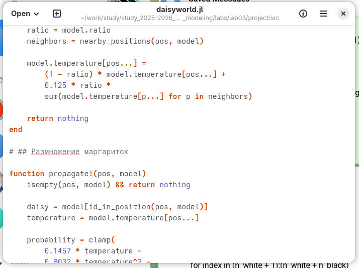
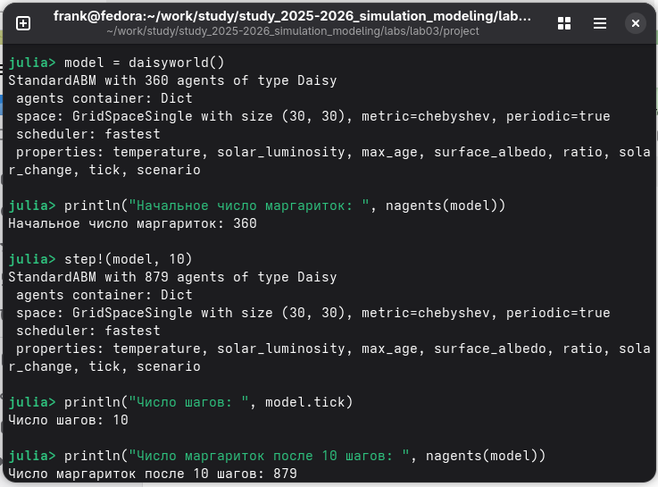
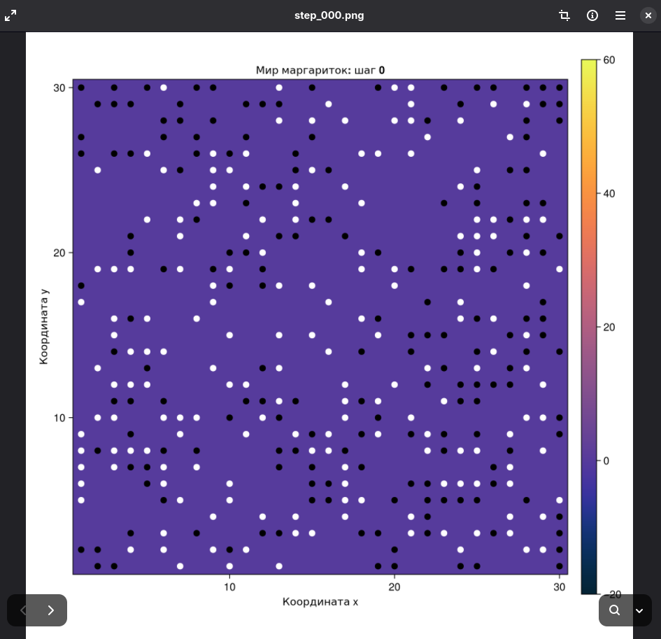
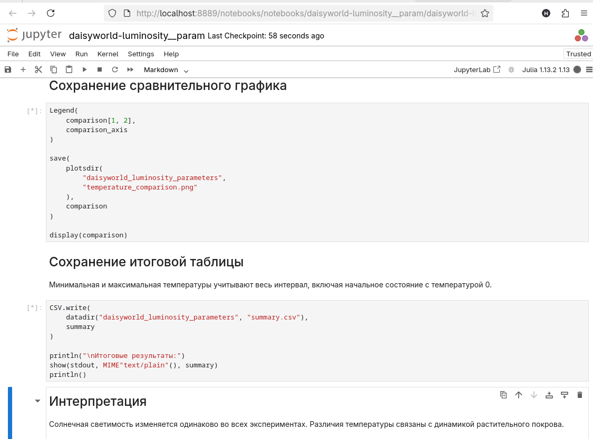

---
## Author
author:
  name: Талебу Тенке Франк
## Title
title: Лабораторная работа № 3
subtitle: Агентное моделирование
date: today
date-format: "YYYY-MM-DD"
---

# Информация

## Докладчик

- **Талебу Тенке Франк**
- **Студенческий билет:** 1032224534
- Российский университет дружбы народов имени Патриса Лумумбы
- Дисциплина: Имитационное моделирование
- Лабораторная работа № 3

::: notes
Представиться и назвать тему лабораторной работы: агентное моделирование.
:::

# Вводная часть

## Актуальность

- Агентное моделирование изучает сложные системы через взаимодействие отдельных агентов.
- Коллективное поведение возникает из локальных правил.
- Модель Daisyworld позволяет исследовать связь популяций и температуры среды.

::: notes
Объяснить, что агентный подход позволяет наблюдать общую динамику на основе поведения отдельных элементов.
:::

## Объект и предмет исследования

- **Объект:** искусственная экосистема «Мир маргариток» (Daisyworld).
- **Предмет:** влияние поведения агентов и параметров среды на численность популяций и температуру.

::: notes
В модели рассматриваются чёрные и белые маргаритки, взаимодействующие с окружающей средой.
:::

## Цели и задачи

**Цель:** освоить агентный подход на примере Daisyworld.

- Реализовать модель на Julia с использованием Agents.jl.
- Построить визуализации и графики динамики.
- Подготовить код и документацию в литературном стиле.
- Исследовать влияние параметров модели.

::: notes
Кратко перечислить этапы лабораторной работы.
:::

## Материалы и методы

- **Julia, Agents.jl:** реализация агентов и правил взаимодействия.
- **Daisyworld:** модель взаимодействия маргариток и температуры.
- **Jupyter Notebook:** запуск и анализ вычислений.
- **Quarto:** воспроизводимая документация и отчёт.

::: notes
Объяснить назначение инструментов, использованных в работе.
:::

# Ход выполнения работы

## Реализация модели на Agents.jl

- Создан файл `src/daisyworld.jl`.
- Определены агенты и функции изменения состояния модели.

{width=70%}

## выполнение 

{width=70%}

## выполнение 
{width=70%}

## выполнение 
{width=70%}

## выполнение 
{width=70%}

## выполнение 
{width=70%}

## выполнение 
{width=70%}

## выполнение 
{width=70%}

## выполнение 
{width=70%}

## выполнение 
{width=70%}

## выполнение 
{width=70%}

## выполнение 
{width=70%}

## выполнение 
{width=70%}

## выполнение 
{width=70%}

## выполнение 
{width=70%}

# Заключение

## Главный вывод

- Реализована агентная модель Daisyworld на Julia.
- Получены визуализации и графики динамики популяций.
- Исследовано влияние параметров на поведение системы.
- Освоены инструменты Agents.jl, Jupyter Notebook и Quarto.

::: notes
Кратко сказать, что цель лабораторной работы достигнута.
:::
