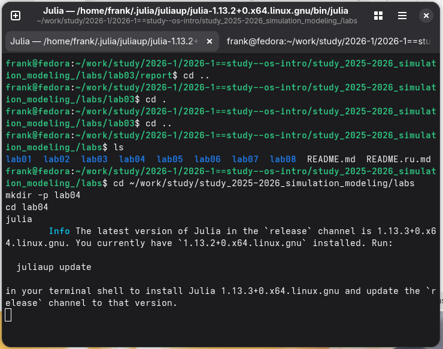
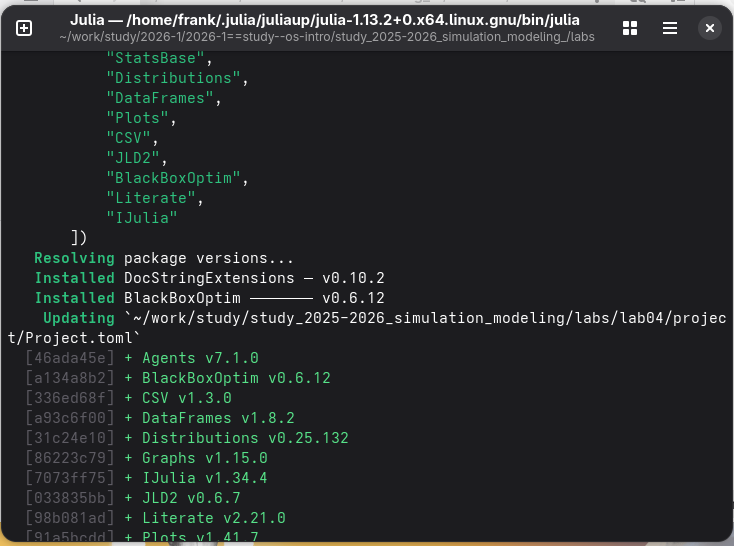
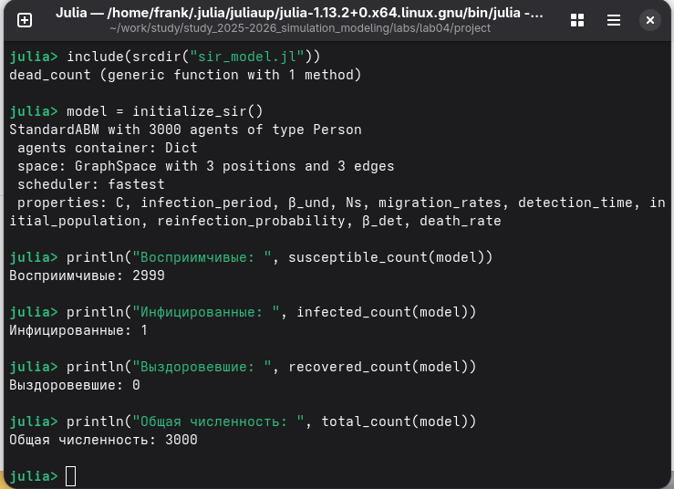
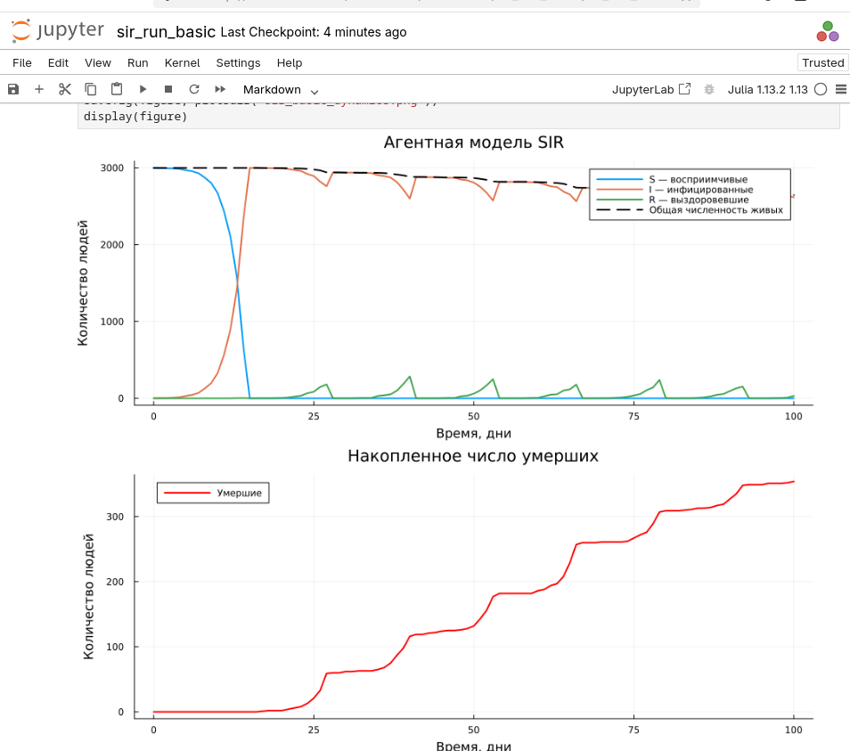
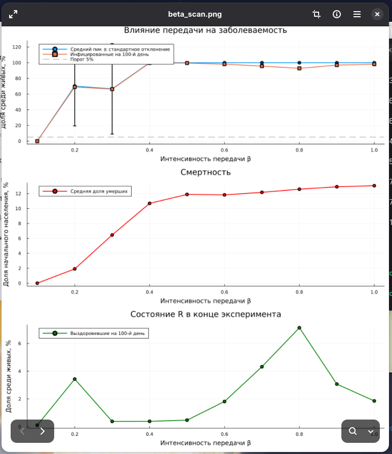
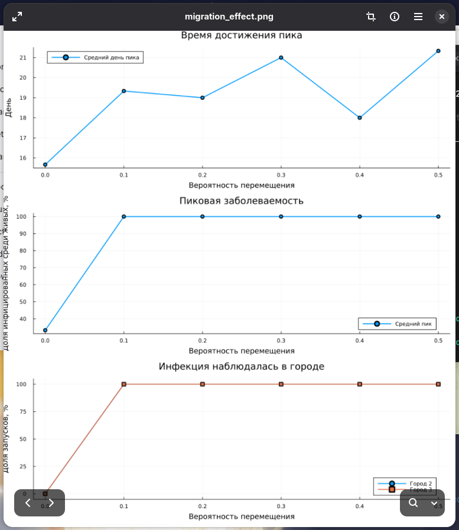
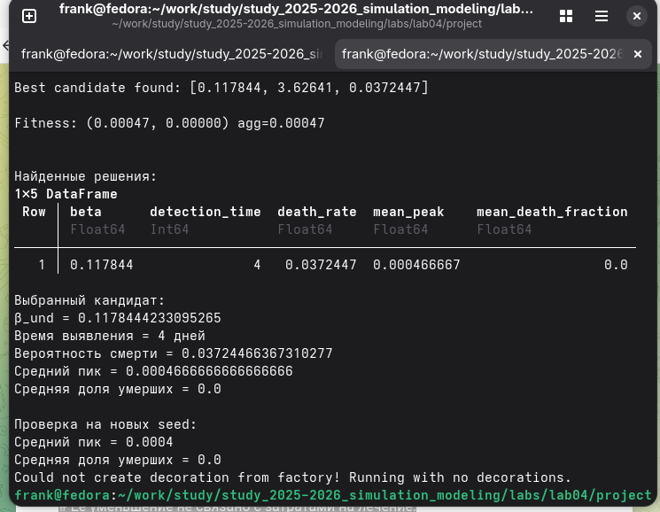
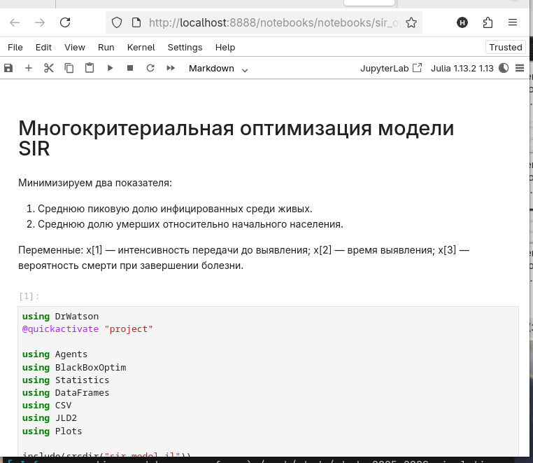
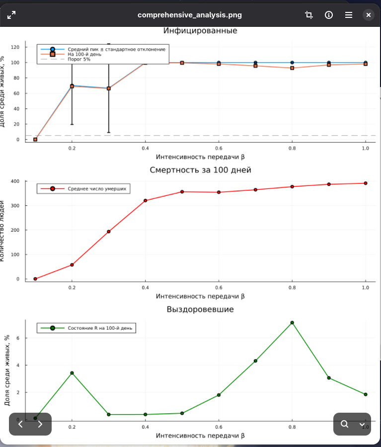
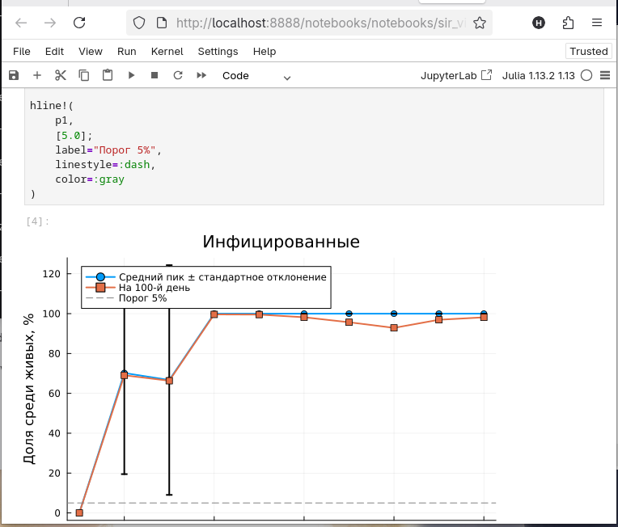

---
## Author
author:
  name: Талебу Тенке Франк
## Title
title: Лабораторная работа № 4
subtitle: Реализация основных моделей в агентном подходе
date: today
date-format: "YYYY-MM-DD"
---

# Информация

## Докладчик

- **Талебу Тенке Франк**
- **Студенческий билет:** 1032224534
- Российский университет дружбы народов имени Патриса Лумумбы
- Дисциплина: Имитационное моделирование
- Лабораторная работа № 4

::: notes
Представиться и назвать тему: реализация модели SIR в агентном подходе.
:::

# Вводная часть

## Актуальность

- Распространение инфекции зависит от взаимодействий отдельных людей.
- Агентное моделирование учитывает индивидуальные характеристики и случайные события.
- В отличие от системы дифференциальных уравнений, модель Agents.jl описывает поведение агентов.

::: notes
Объяснить, почему агентный подход подходит для изучения эпидемий.
:::

## Объект и предмет исследования

- **Объект:** распространение инфекционного заболевания в популяции.
- **Предмет:** динамика групп S, I, R и влияние заразности, миграции и параметров модели.

::: notes
Уточнить, что S — восприимчивые, I — инфицированные, R — выздоровевшие.
:::

## Цели и задачи

**Цель:** реализовать агентную модель SIR с помощью Julia и Agents.jl.

- Запустить базовый эксперимент.
- Исследовать изменение коэффициента заразности.
- Оценить влияние миграции между городами.
- Рассмотреть оптимизацию параметров и итоговую визуализацию.

::: notes
Перечислить основные этапы лабораторной работы.
:::

## Материалы и методы

- **Julia, Agents.jl:** программирование агентной модели.
- **SIR:** состояния восприимчивых, инфицированных и выздоровевших.
- **Параметрическое сканирование:** серия экспериментов при разных значениях заразности.
- **BlackBoxOptim:** многокритериальная оптимизация параметров.
- **Quarto и Jupyter:** оформление и воспроизводимость результатов.

::: notes
Назвать основные инструменты и их назначение.
:::

## Ход выполнения работы

{width=70%}

## выполнение 

{width=70%}

## выполнение 
{width=70%}

## выполнение 
{width=70%}

## выполнение 
{width=70%}

## выполнение 
{width=70%}

## выполнение 
{width=70%}

## выполнение 
{width=70%}

## выполнение 
{width=70%}

## выполнение 
{width=70%}

## выполнение 
{width=70%}

## выполнение 
{width=70%}

## Основные результаты

- Реализована и запущена агентная модель SIR.
- Получены графики базовой динамики эпидемии.
- Исследовано влияние заразности и миграции.
- Рассмотрены оптимизация параметров и сводный анализ результатов.

::: notes
Кратко подвести итог выполненных экспериментов.
:::

# Заключение

## Выводы

- Освоена реализация модели SIR в агентном подходе.
- Агентная модель позволяет учитывать индивидуальные взаимодействия и случайность.
- Серии экспериментов помогают оценить влияние параметров на динамику эпидемии.

::: notes
Завершить выступление и сформулировать основные результаты работы.
:::

## Спасибо за внимание!

::: notes
Поблагодарить за внимание и предложить задать вопросы.
:::
