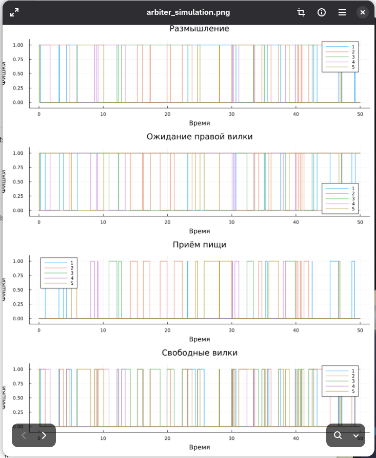
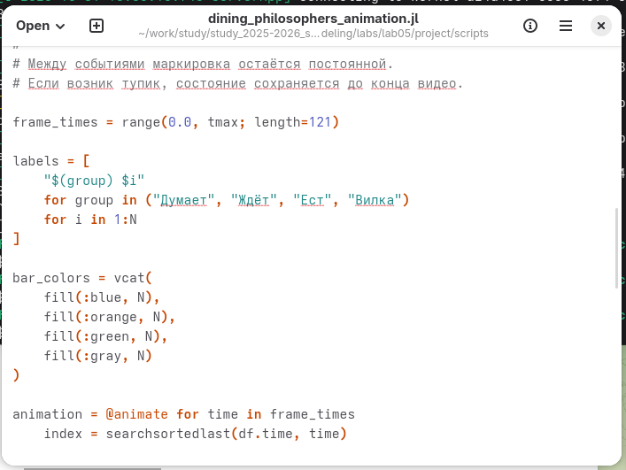
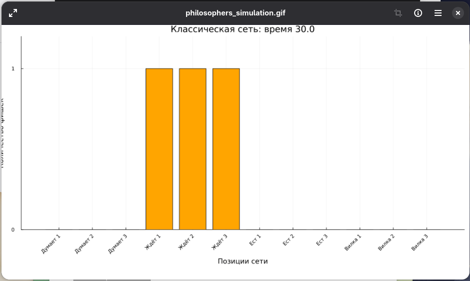
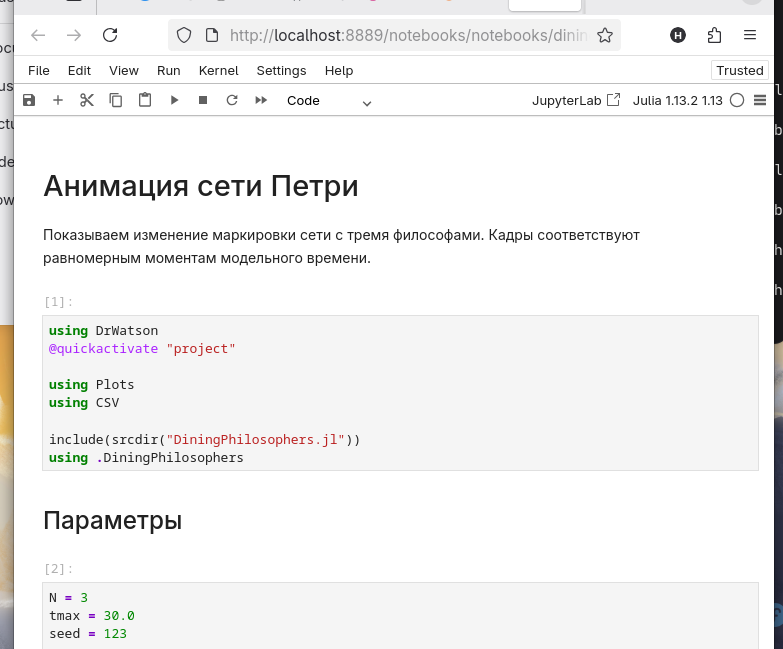
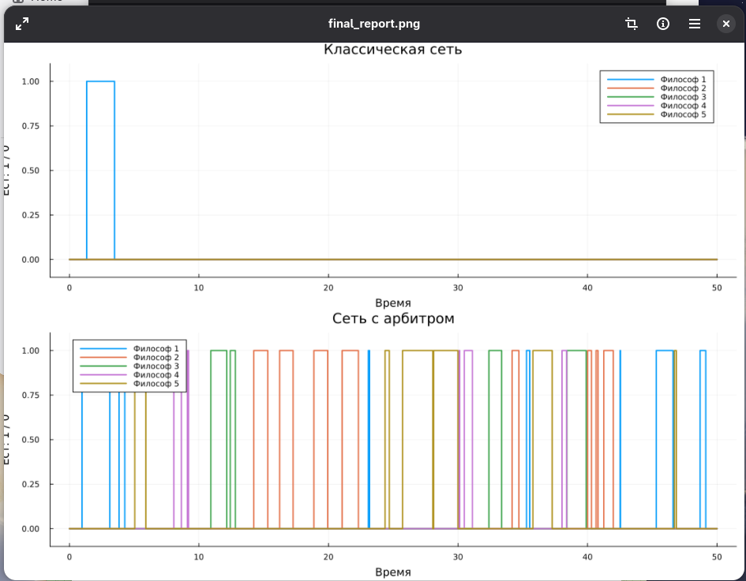
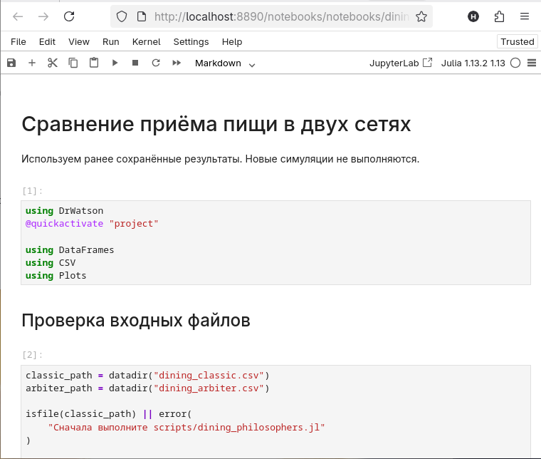
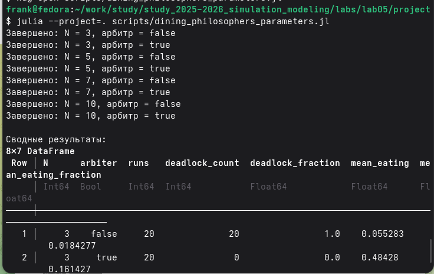
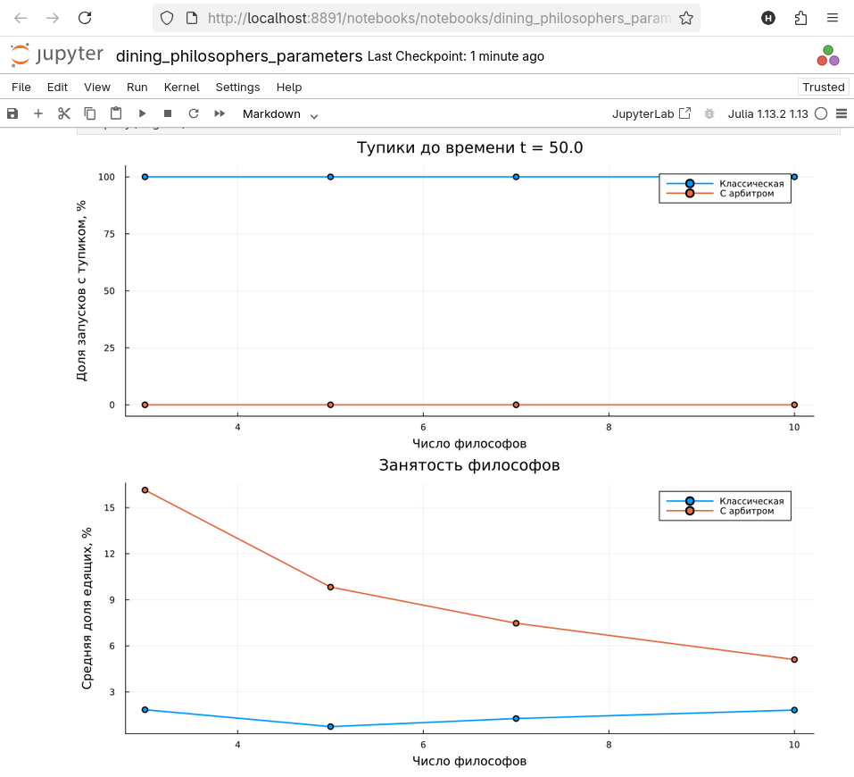

---
## Author
author:
  name: Талебу Тенке Франк
## Title
title: Лабораторная работа № 5
subtitle: Аппарат сетей Петри
date: today
date-format: "YYYY-MM-DD"
---

# Информация

## Докладчик

- **Талебу Тенке Франк**
- **Студенческий билет:** 1032224534
- Российский университет дружбы народов имени Патриса Лумумбы
- Дисциплина: Имитационное моделирование
- Лабораторная работа № 5

::: notes
Представиться и назвать тему: аппарат сетей Петри и задача обедающих философов.
:::

# Вводная часть

## Актуальность

- Сети Петри позволяют описывать параллельные процессы и конкуренцию за ресурсы.
- Взаимная блокировка (deadlock) возникает, когда участники ожидают ресурсы друг друга.
- Задача обедающих философов демонстрирует эту проблему на простом примере.

::: notes
Объяснить, почему важно обнаруживать блокировки в параллельных системах.
:::

## Объект и предмет исследования

- **Объект:** система пяти философов, использующих общие вилки.
- **Предмет:** переходы между состояниями размышления, ожидания и приёма пищи, а также возникновение и предотвращение deadlock.

::: notes
Пояснить, что каждый философ должен получить две вилки, чтобы начать есть.
:::

## Цели и задачи

**Цель:** построить и исследовать сеть Петри для задачи обедающих философов.

- Реализовать классическую сеть Петри.
- Провести моделирование и обнаружить взаимную блокировку.
- Добавить арбитра для управления доступом к вилкам.
- Сравнить поведение двух вариантов модели.

::: notes
Кратко перечислить этапы исследования.
:::

## Материалы и методы

- **Julia:** реализация модели и запуск экспериментов.
- **Сети Петри:** позиции, переходы и маркировка фишками.
- **Имитационное моделирование:** исследование динамики состояний.
- **Графики и анимация:** сравнение классической модели и модели с арбитром.
- **Quarto и Jupyter:** оформление воспроизводимых результатов.

::: notes
Объяснить, что маркировка сети показывает текущее состояние системы.
:::

## выполнение 
{width=70%}
## выполнение 
{width=70%}
## выполнение 
{width=70%}
## выполнение 
{width=70%}
## выполнение 
{width=70%}

## выполнение 
{width=70%}
## выполнение 
{width=70%}

## выполнение 
{width=70%}

## выполнение 
{width=70%}
## выполнение 
{width=70%}
## выполнение 
{width=70%}
## выполнение 
{width=70%}

# Результаты и обсуждение

## Основные результаты

- Реализована сеть Петри для задачи пяти обедающих философов.
- Исследовано возникновение deadlock в классической модели.
- Рассмотрена модификация с арбитром.
- Подготовлены графики и анимация для сравнения поведения моделей.

::: notes
Кратко перечислить полученные результаты и значение сравнения.
:::

# Заключение

## Выводы

- Освоен аппарат сетей Петри для моделирования параллельных процессов.
- Показано, как конкуренция за ресурсы может приводить к взаимной блокировке.
- Механизм арбитра позволяет организовать доступ к ресурсам и предотвратить deadlock в рассмотренной модели.

::: notes
Завершить доклад, сформулировав главную идею лабораторной работы.
:::

## Спасибо за внимание!

::: notes
Поблагодарить за внимание и предложить задать вопросы.
:::
