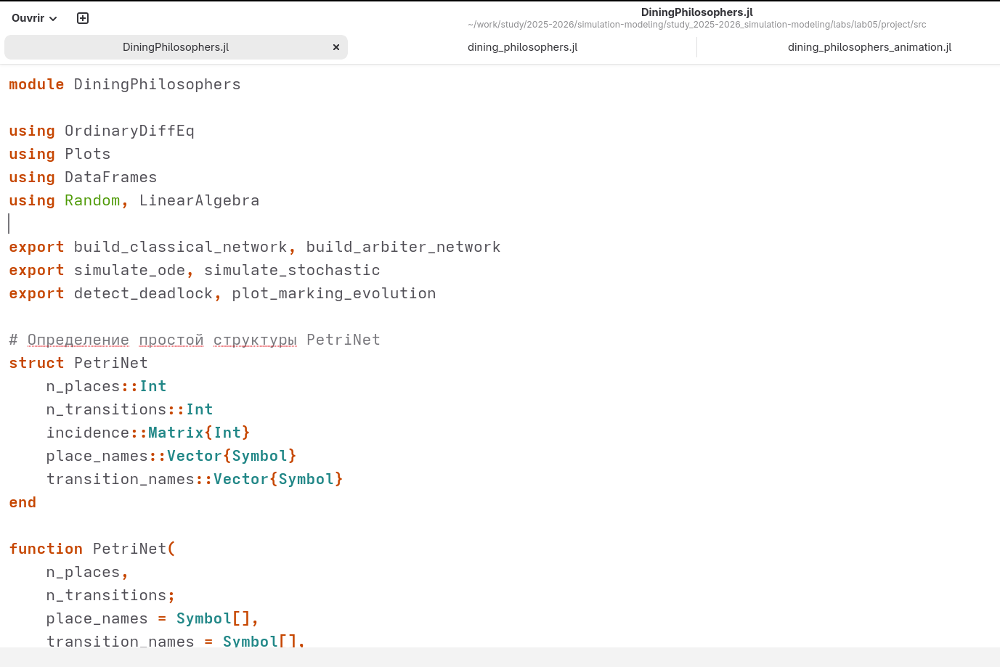
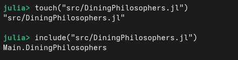
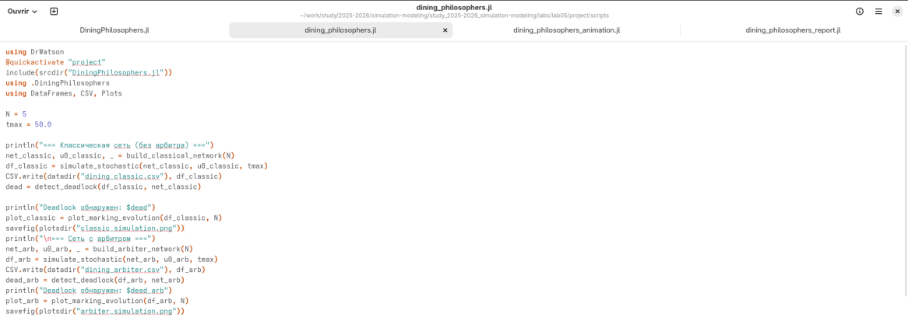
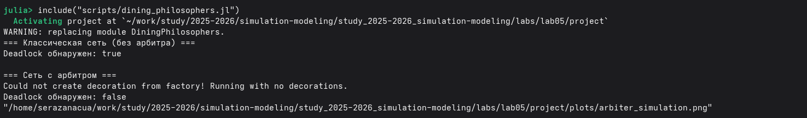
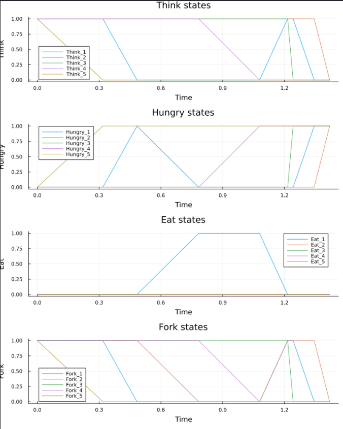
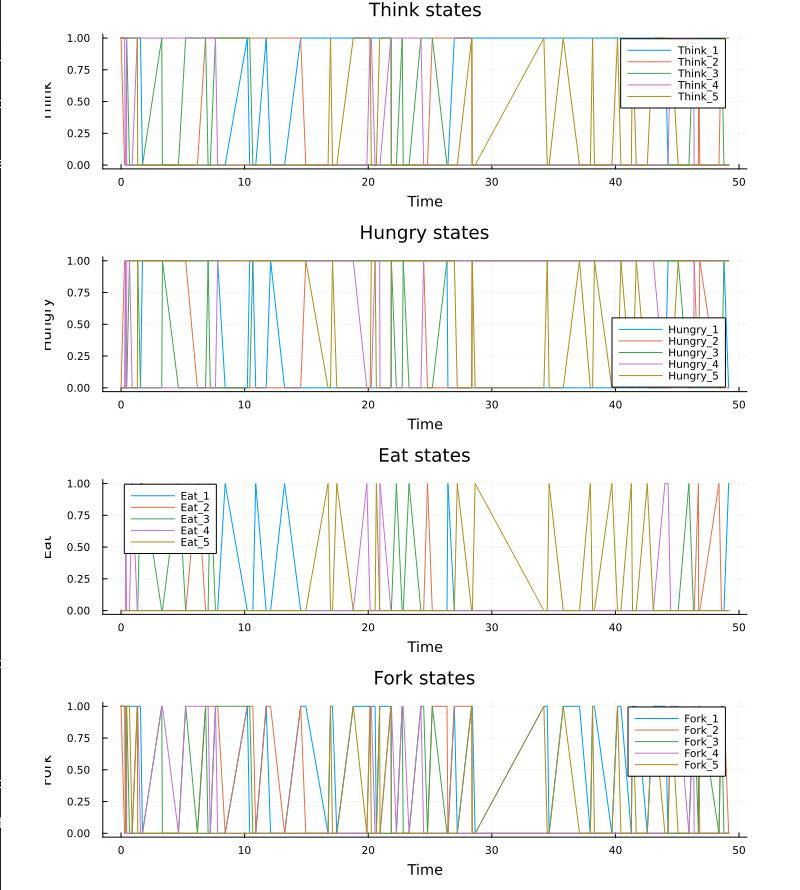
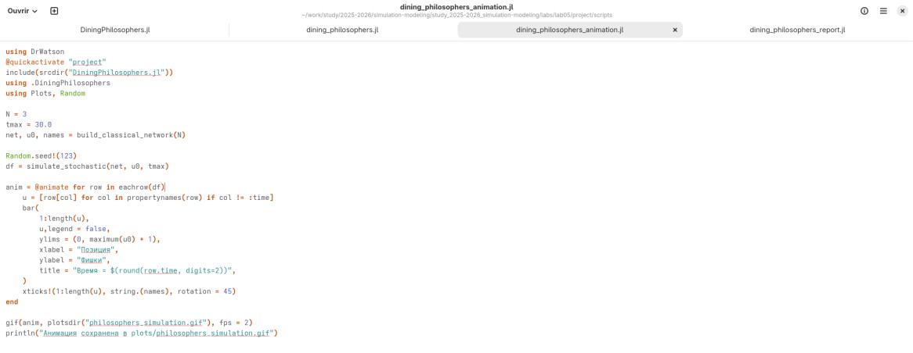
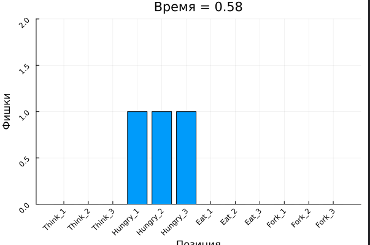
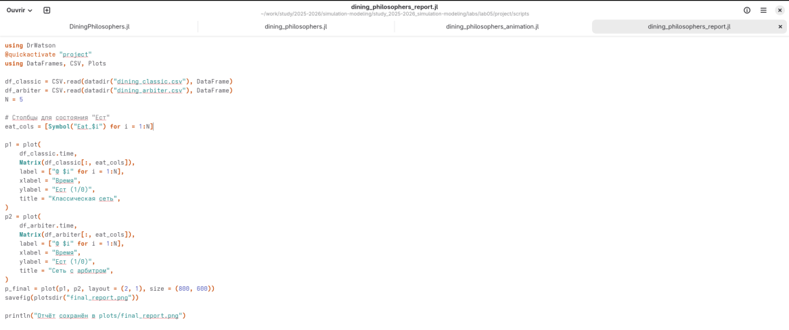
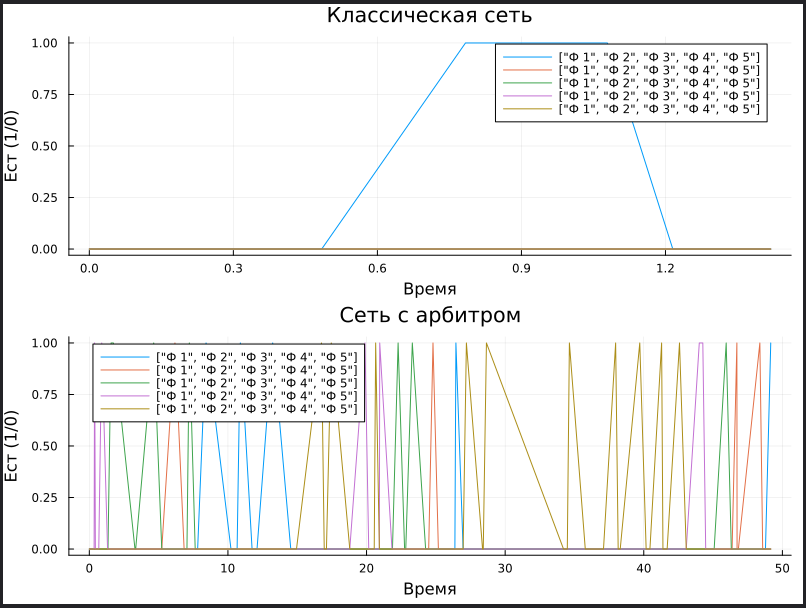

**Студент:** Талебу Тенке Франк  
**Студенческий номер:** 1032224534  
**Лабораторная работа № 5:** Аппарат сетей Петри

\newpage

# Введение

В лабораторной работе исследуется задача обедающих философов с использованием аппарата сетей Петри. Рассматриваются распределение общих ресурсов, возникновение взаимной блокировки и способ её предотвращения с помощью арбитра.

\newpage

## Актуальность

Сети Петри позволяют моделировать параллельные процессы и совместное использование ограниченных ресурсов. Задача обедающих философов демонстрирует, как взаимное ожидание ресурсов может привести к остановке системы.

\newpage

## Цель работы

Построить сеть Петри для пяти философов, исследовать состояние взаимной блокировки (*deadlock*) в классической модели, модифицировать сеть с помощью арбитра и сравнить результаты моделирования.

\newpage

## Задачи

1. Создать рабочий каталог и установить необходимые пакеты.
2. Реализовать модель пяти обедающих философов на Julia.
3. Провести эксперимент для классической сети Петри и сети с арбитром.
4. Построить графики изменения маркировки сети.
5. Подготовить анимацию процесса.
6. Сравнить модели по состояниям философов и оформить результаты.
7. Подготовить производные форматы литературного кода согласно заданию лабораторной работы.

\newpage

# Теоретическая часть

Сеть Петри состоит из **позиций**, **переходов** и **фишек**. Распределение фишек по позициям называется *маркировкой* и характеризует текущее состояние системы.

В задаче обедающих философов каждый из пяти философов может находиться в состоянии **Think** (размышляет), **Hungry** (голоден) или **Eat** (ест). Для приёма пищи необходимы две соседние вилки. Если все философы удерживают по одной вилке и ожидают вторую, возникает взаимная блокировка (*deadlock*).

Модифицированная сеть с **арбитром** координирует доступ к вилкам и предназначена для предотвращения такой ситуации.

\newpage

# Материалы и методы

Для работы использовались язык Julia, программная реализация сети Петри в файле `src/DiningPhilosophers.jl`, сценарии моделирования, графики эволюции маркировки и анимация. Исследовались два варианта: классическая сеть без арбитра и сеть с арбитром.

\newpage

# Выполнение лабораторной работы

Выполнение работы включает реализацию сети Петри, базовый эксперимент, анимацию и итоговое сравнение моделей.

\newpage

## Обедающие философы: реализация сети Петри

Создан файл `src/DiningPhilosophers.jl`, содержащий структуру сети и функции для построения и моделирования вариантов задачи обедающих философов.

{width=75% fig-pos="H"}

\newpage

## Подключение модуля в Julia

Реализованный модуль подключён в среде Julia, что позволяет использовать функции построения сетей и моделирования.

{width=75% fig-pos="H"}

\newpage

## Базовый эксперимент: классическая сеть и сеть с арбитром

Подготовлено сравнение классической сети, допускающей взаимную блокировку, и модифицированной сети с арбитром.

{width=75% fig-pos="H"}

\newpage

## Запуск базового эксперимента

Создан и выполнен сценарий `scripts/dining_philosophers.jl` для запуска моделирования и сохранения результатов.

{width=75% fig-pos="H"}

\newpage

## Эволюция маркировки классической сети

Построены графики состояний **Think**, **Hungry**, **Eat** и доступности вилок. В классическом варианте возможно прекращение переходов к приёму пищи из-за взаимного ожидания ресурсов.

{width=75% fig-pos="H"}

\newpage

## Эволюция маркировки сети с арбитром

В сети с арбитром наблюдается чередование состояний философов и продолжение процесса приёма пищи.

{width=75% fig-pos="H"}

\newpage

## Анимация процесса: программная реализация

Подготовлен сценарий анимации для отображения изменений маркировки сети Петри во времени.

{width=75% fig-pos="H"}

\newpage

## Анимация процесса: визуализация состояний

Анимация иллюстрирует перемещение фишек и переходы философов между состояниями **Think**, **Hungry** и **Eat**.

{width=75% fig-pos="H"}

\newpage

## Итоговый отчёт: подготовка сравнения

Создан сценарий для сравнительного анализа двух моделей по числу философов, находящихся в состоянии **Eat**.

{width=75% fig-pos="H"}

\newpage

## Итоговый отчёт: сравнительный график

На итоговом графике сопоставлены изменения состояния **Eat** в классической сети и сети с арбитром.

{width=75% fig-pos="H"}

\newpage

# Результаты

Реализованы два варианта сети Петри для задачи пяти обедающих философов. Построены графики эволюции маркировки, подготовлена анимация и выполнено итоговое сравнение классической сети с сетью, использующей арбитра.

\newpage

# Обсуждение результатов

В классической сети возможна взаимная блокировка, при которой философы не могут продолжить приём пищи. На сравнительном графике это проявляется прекращением переходов в состояние **Eat**. В модели с арбитром доступ к вилкам согласуется, поэтому процесс продолжается. Результаты показывают роль координации при использовании общих ресурсов.

\newpage

# Заключение

В ходе лабораторной работы изучен аппарат сетей Петри на примере задачи обедающих философов. Реализованы и исследованы классическая модель и модель с арбитром. Построенные графики и анимация позволяют проанализировать возникновение взаимной блокировки и способ её предотвращения.

\newpage

# Список литературы

1. Материалы лабораторной работы № 5 «Аппарат сетей Петри».
