---
## Author
author:
  name: Талебу Тенке Франк
## Title
title: Лабораторная работа № 6
subtitle: Модель SIR с использованием сетей Петри
date: today
date-format: "YYYY-MM-DD"
---

# Информация

## Докладчик

- **Талебу Тенке Франк**
- **Студенческий билет:** 1032224534
- Российский университет дружбы народов имени Патриса Лумумбы
- Дисциплина: Имитационное моделирование
- Лабораторная работа № 6

::: notes
Представиться и назвать тему: моделирование эпидемии SIR с помощью сетей Петри.
:::

# Вводная часть

## Актуальность

- Модель SIR описывает распространение инфекции в популяции.
- Сети Петри позволяют наглядно представить состояния и переходы между ними.
- Сравнение детерминированного и стохастического подходов помогает оценить влияние случайности.

::: notes
Объяснить, зачем нужны разные способы моделирования эпидемии.
:::

## Объект и предмет исследования

- **Объект:** распространение инфекционного заболевания в популяции.
- **Предмет:** переходы между группами восприимчивых, инфицированных и выздоровевших, а также влияние коэффициента заражения β.

::: notes
Назвать три группы S, I и R и объяснить их смысл.
:::

## Цели и задачи

**Цель:** реализовать и исследовать модель SIR на основе сетей Петри в Julia.

- Создать и запустить код модели.
- Выполнить базовый детерминированный и стохастический прогоны.
- Исследовать влияние коэффициента заражения β.
- Подготовить сравнительные графики и итоговый анализ.

::: notes
Кратко перечислить основные этапы лабораторной работы.
:::

## Материалы и методы

- **Julia:** реализация и запуск вычислительных экспериментов.
- **Сети Петри:** состояния S, I, R и переходы заражения и выздоровления.
- **DrWatson:** организация проекта и путей к файлам.
- **Jupyter и Quarto:** выполнение, документирование и представление результатов.

::: notes
Пояснить, какие инструменты использованы для моделирования и оформления.
:::

## выполнение 
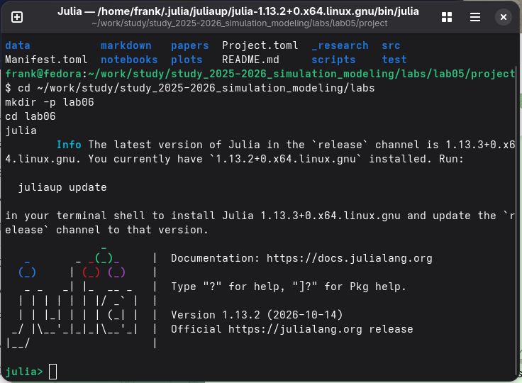{width=70%}

## выполнение 
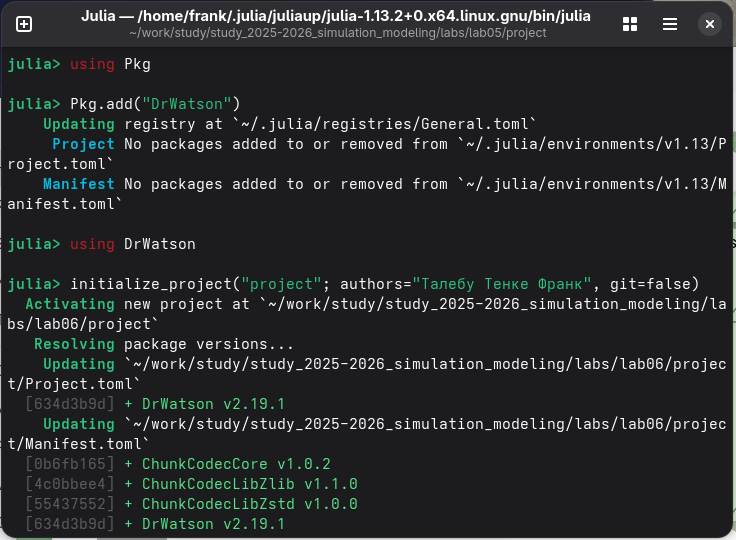{width=70%}

## выполнение 
{width=70%}

## выполнение 
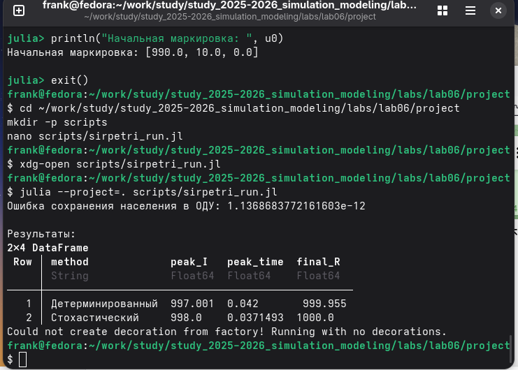{width=70%}

## выполнение 
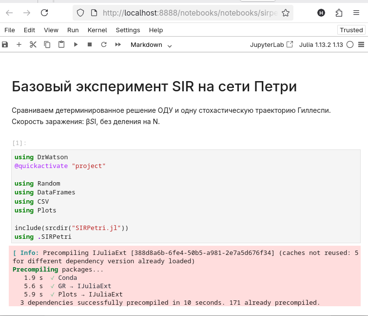{width=70%}

## выполнение 
{width=70%}

## выполнение 
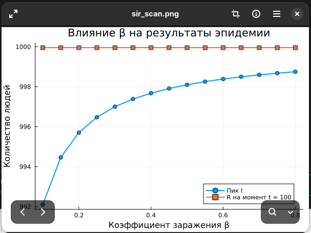{width=70%}

## выполнение 
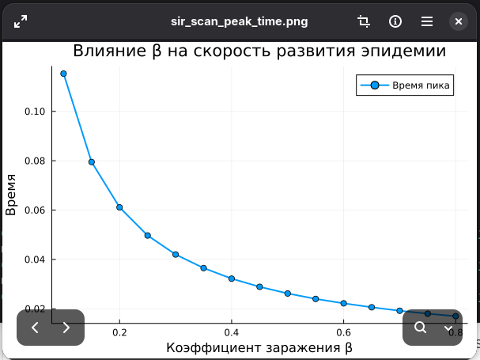{width=70%}

## выполнение 
{width=70%}

## выполнение 
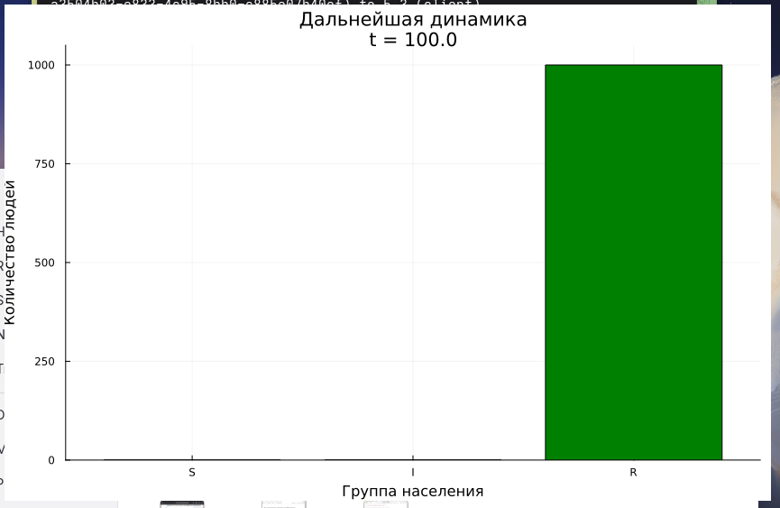{width=70%}

## выполнение 
{width=70%}

## выполнение 
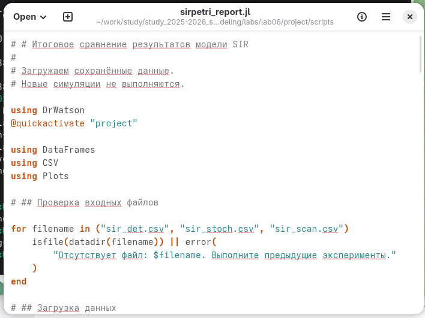{width=70%}

## выполнение 
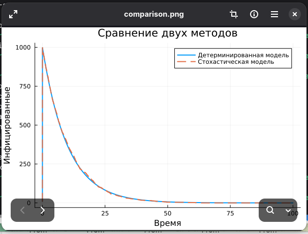{width=70%}

## выполнение 
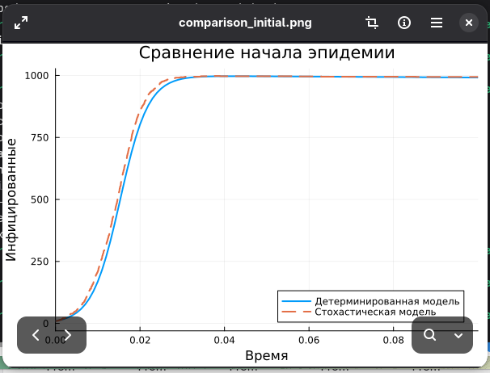{width=70%}

## выполнение 
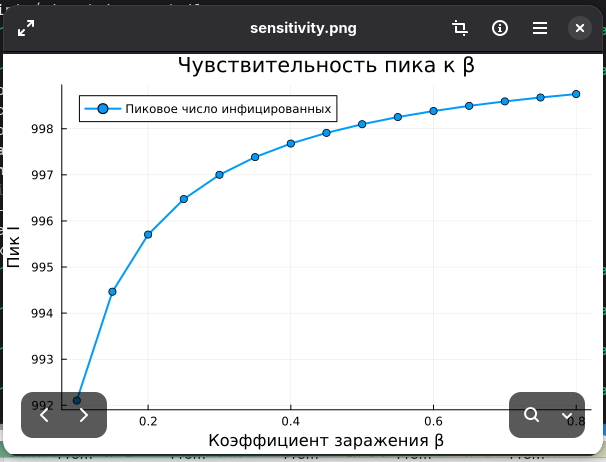{width=70%}

## выполнение 
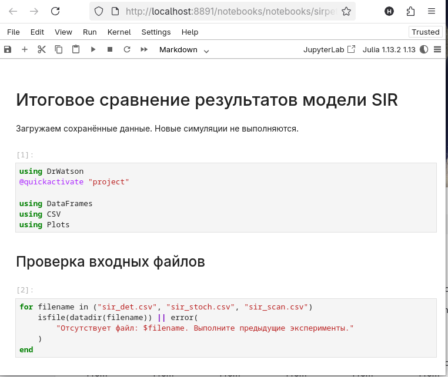{width=70%}

# Результаты и обсуждение

## Основные результаты

- Реализована модель SIR с использованием сетей Петри.
- Выполнены детерминированный и стохастический прогоны.
- Проведено исследование изменения коэффициента заражения β.
- Подготовлены сравнительные графики для итогового отчёта.

::: notes
Кратко обобщить выполненные этапы и полученные материалы.
:::

# Заключение

## Выводы

- Сети Петри позволяют описать переходы между эпидемиологическими состояниями.
- Детерминированное моделирование показывает ожидаемую динамику, а стохастическое — возможные отклонения.
- Изменение β позволяет исследовать чувствительность пика заболеваемости и общего масштаба эпидемии.

::: notes
Сформулировать главный вывод о пользе моделирования SIR и анализа параметров.
:::

## Спасибо за внимание!

::: notes
Поблагодарить аудиторию и предложить задать вопросы.
:::
