---
## Front matter
title: "Шаблон отчёта по лабораторной работе № 6"
subtitle: "Реализация основных моделей в подходе сетей Петри"
author: "Талебу Тенке Франк Устон"

## Generic otions
lang: ru-RU
toc-title: "Содержание"

## Bibliography
bibliography: bib/cite.bib
csl: pandoc/csl/gost-r-7-0-5-2008-numeric.csl

## Pdf output format
toc: true # Table of contents
toc-depth: 2
lof: true # List of figures
lot: true # List of tables
fontsize: 12pt
linestretch: 1.5
papersize: a4
documentclass: scrreprt

## I18n polyglossia
polyglossia-lang:
  name: russian
  options:
    - spelling=modern
    - babelshorthands=true
polyglossia-otherlangs:
  name: english

## I18n babel
babel-lang: russian
babel-otherlangs: english

## Fonts
mainfont: PT Serif
romanfont: PT Serif
sansfont: PT Sans
monofont: PT Mono
mainfontoptions: Ligatures=TeX
romanfontoptions: Ligatures=TeX
sansfontoptions: Ligatures=TeX,Scale=MatchLowercase
monofontoptions: Scale=MatchLowercase,Scale=0.9

## Biblatex
biblatex: true
biblio-style: "gost-numeric"
biblatexoptions:
  - parentracker=true
  - backend=biber
  - hyperref=auto
  - language=auto
  - autolang=other*
  - citestyle=gost-numeric

## Pandoc-crossref LaTeX customization
figureTitle: "Рис."
tableTitle: "Таблица"
listingTitle: "Листинг"
lofTitle: "Список иллюстраций"
lotTitle: "Список таблиц"
lolTitle: "Листинги"

## Misc options
indent: true
header-includes:
  - \usepackage{indentfirst}
  - \usepackage{float}
  - \floatplacement{figure}{H}
---

# Цель работы

Реализация математической модели эпидемии SIR с использованием аппарата сетей Петри в языке программирования Julia, а также проведение детерминированного и стохастического анализа динамики распространения заболевания.

# Задание

1. Код модели.
2. Базовый прогон модели.
3. Коэффициент заражения.
4. Итоговый отчёт.

# Теоретическое введение

## Модель SIR

Реализована модель эпидемии SIR (Susceptible–Infectious–Recovered) с использованием сетей Петри.

Модель описывает переходы между тремя состояниями:

- восприимчивые — могут заразиться;
- инфицированные — заражают других и выздоравливают;
- выздоровевшие — с иммунитетом, больше не участвуют в эпидемии.

Сеть Петри содержит два перехода:

- `infection` — скорость заражения;
- `recovery` — скорость выздоровления.

# Выполнение лабораторной работы

## Код модели

Данный код реализует переход от теоретической схемы эпидемии к вычислимой модели. Благодаря использованию сетей Петри, мы можем гибко настраивать параметры инфекции и автоматически генерировать базу для проведения как обычного, так и случайного анализа динамики популяции (рис. [-@fig:001]).

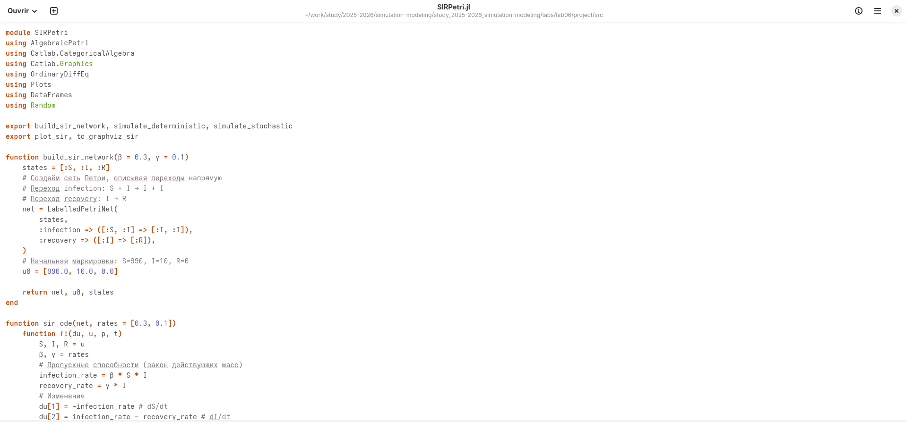{#fig:001 width=100%}

Вывод в консоль (рис. [-@fig:002]).

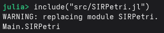{#fig:002 width=100%}

## Базовый прогон модели

В задаче мы объединим логику модели, произведём расчёты и сохраним результаты (рис. [-@fig:003]).

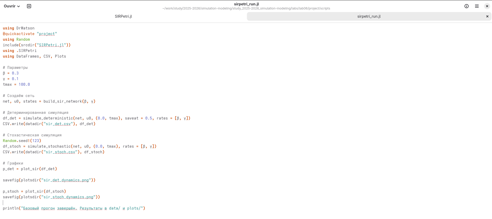{#fig:003 width=100%}

Мы используем библиотеку DrWatson, которая гарантирует, что пути к файлам и структура папок будут одинаковыми на любом компьютере.

Скрипт загружает модуль `SIRPetri.jl` и задаёт ключевые параметры болезни: коэффициент заражения = 0.3 и коэффициент выздоровления = 0.1.

Детерминированный подход рассчитывает «средний» сценарий развития эпидемии. Это даёт чёткие, плавные кривые, полезные для общего прогноза (рис. [-@fig:004]).

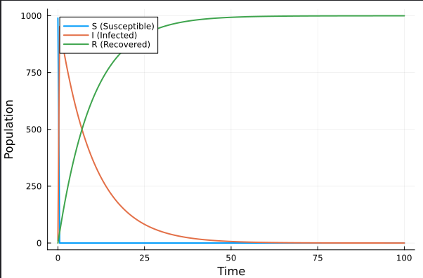{#fig:004 width=100%}

Стохастический подход учитывает фактор случайности через `Random.seed!`. Это имитирует реальную жизнь, где каждое заражение или выздоровление — случайное событие.

Сравнение этих двух подходов позволяет увидеть, насколько сильно случайность может отклонить эпидемию от теоретического среднего (рис. [-@fig:005]).

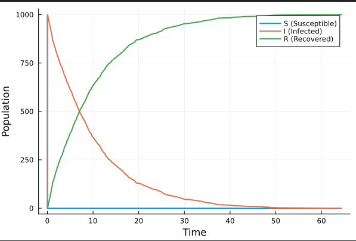{#fig:005 width=100%}

Первая таблица (рис. [-@fig:006]).

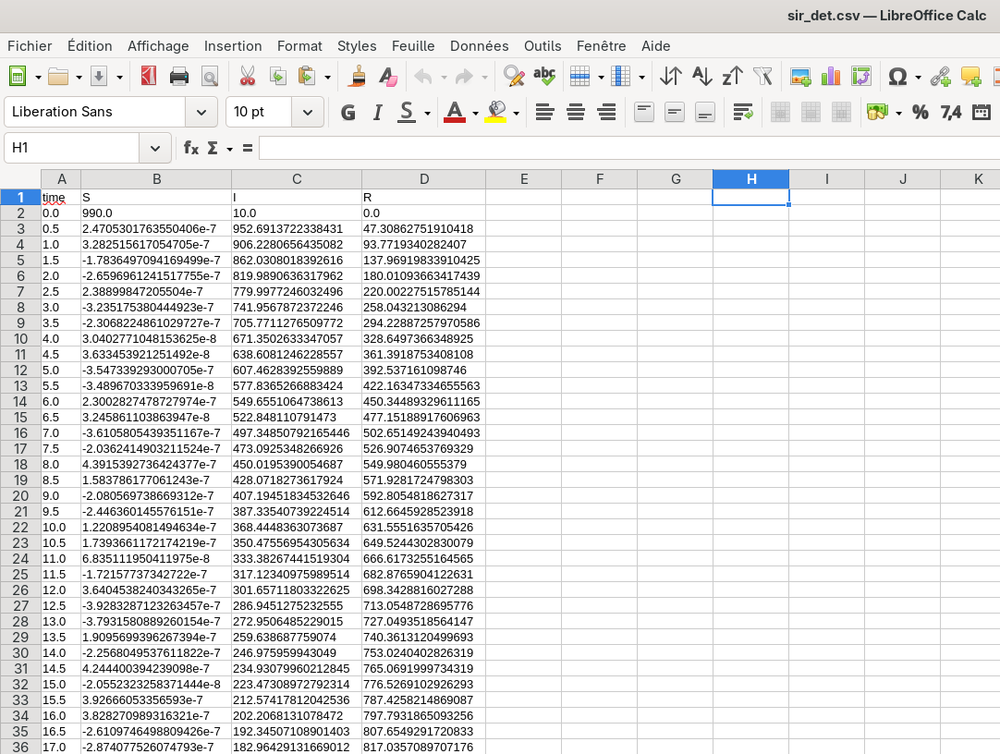{#fig:006 width=100%}

Вторая таблица (рис. [-@fig:007]).

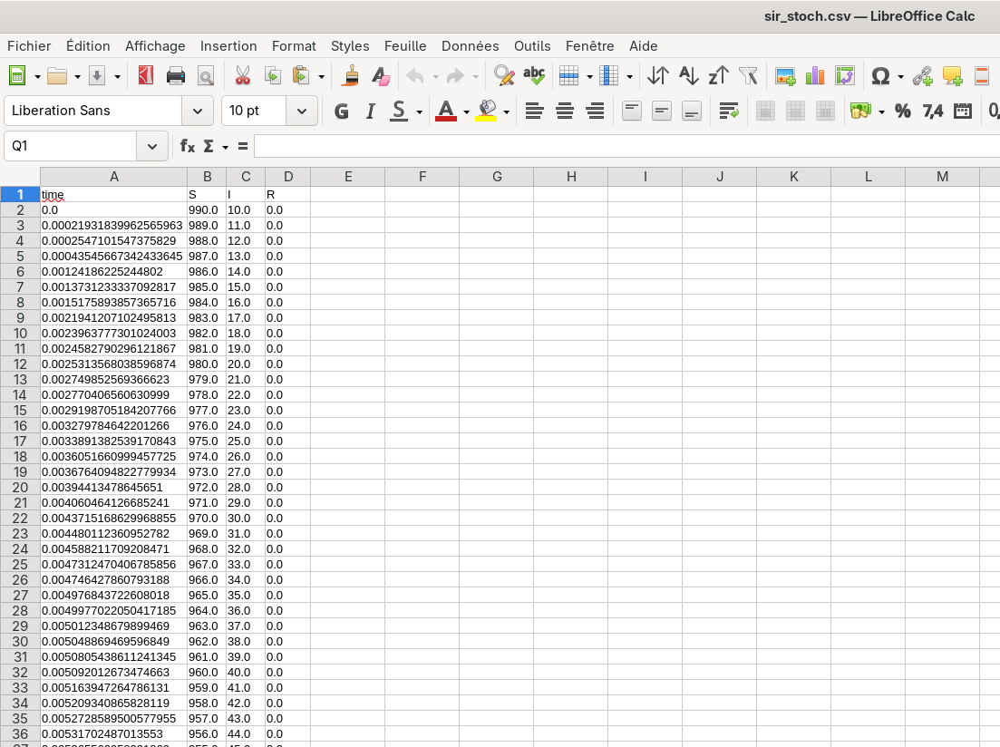{#fig:007 width=100%}

Выполнение кода из Jupyter Notebook (рис. [-@fig:008]).

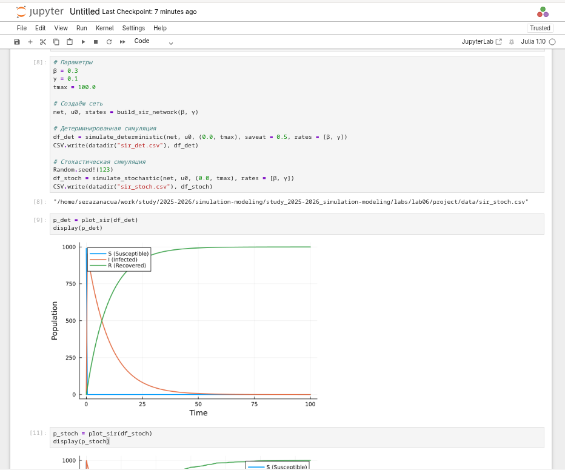{#fig:008 width=100%}

## Коэффициент заражения

Здесь я выяснила, как изменение интенсивности заражения влияет на развитие эпидемии (рис. [-@fig:009]).

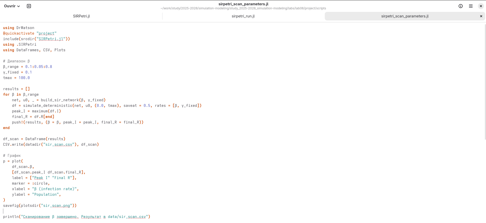{#fig:009 width=100%}

Код запускает цикл симуляций, перебирая значения от 0.1 до 0.8. Для каждого значения фиксируются два показателя:

- пик заболеваемости — максимальная нагрузка на больницы;
- итоговое число переболевших — общий масштаб эпидемии.

(рис. [-@fig:010]).

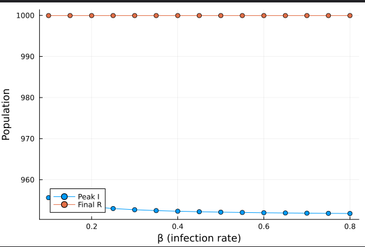{#fig:010 width=100%}

Это исследовательская часть работы, которая показывает не просто один сценарий, а общую закономерность поведения модели (рис. [-@fig:011]).

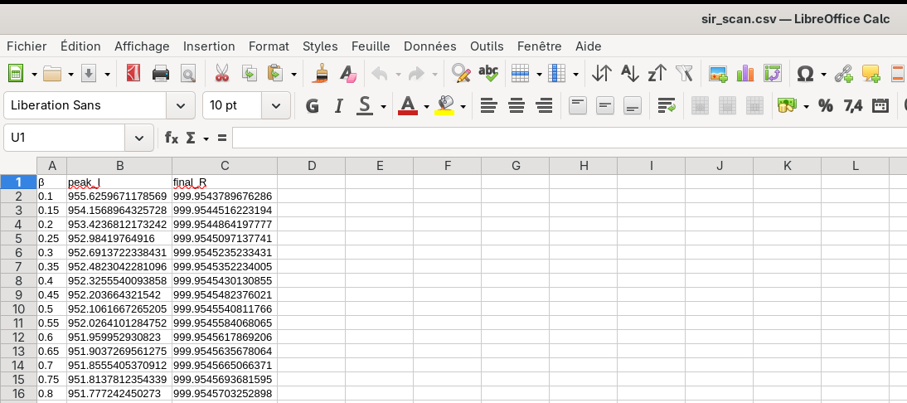{#fig:011 width=100%}

Выполнение кода из Jupyter Notebook (рис. [-@fig:012]).

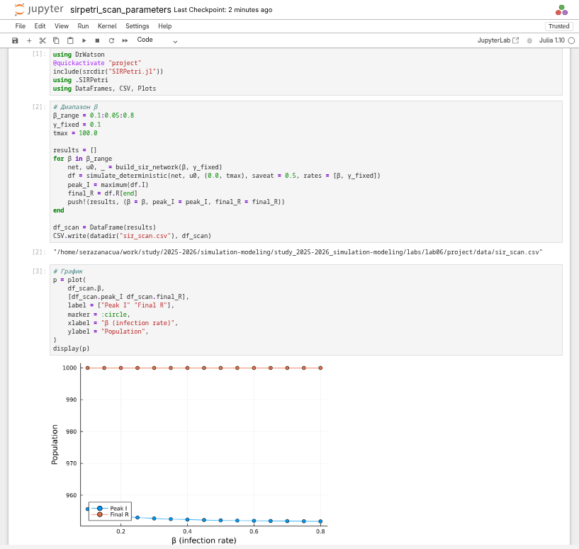{#fig:012 width=100%}

## Итоговый отчёт

Здесь мы выполняем итоговый сравнительный анализ и визуализацию всех полученных данных.

### Интеграция результатов

Скрипт объединяет данные из разных симуляций, что позволяет проводить комплексный анализ без повторных вычислений (рис. [-@fig:013]).

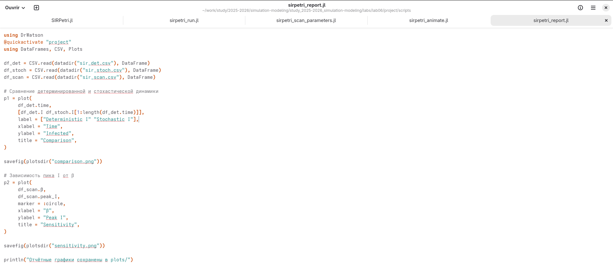{#fig:013 width=100%}

### Анализ отклонений

На графике сравнения (`Comparison`) наглядно демонстрируется, как случайные процессы в стохастической модели создают отклонения от теоретической средней кривой (рис. [-@fig:014]).

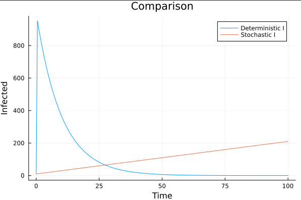{#fig:014 width=100%}

### Оценка рисков

График чувствительности (`Sensitivity`) связывает биологические параметры вируса с его опасностью для популяции — высотой пика заболеваемости (рис. [-@fig:015]).

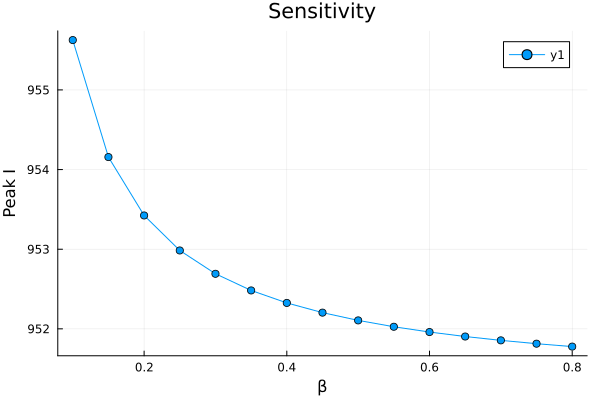{#fig:015 width=100%}

Выполнение кода из Jupyter Notebook (рис. [-@fig:016]).

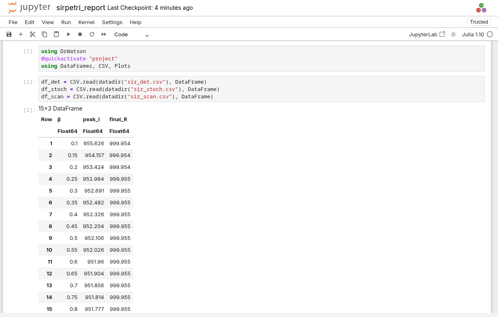{#fig:016 width=100%}

Выполнение кода из Jupyter Notebook (рис. [-@fig:017]).

{#fig:017 width=100%}

# Выводы

Мы прошли путь от описания модели через сети Петри до получения конкретных графиков, которые позволяют прогнозировать нагрузку на систему здравоохранения в зависимости от параметров инфекции.

# Список литературы{.unnumbered}

https://esystem.rudn.ru/pluginfile.php/3145800/mod_resource/content/1/lab06.pdf

::: {#refs}
:::