**Студент:** Талебу Тенке Франк  
**Студенческий номер:** 1032224534  
**Лабораторная работа № 6:** Реализация основных моделей в подходе сетей Петри

\newpage

# Введение

Лабораторная работа посвящена исследованию распространения инфекционного заболевания с помощью модели SIR, реализованной на основе аппарата сетей Петри в Julia.

\newpage

## Актуальность

Сети Петри позволяют описывать переходы между состояниями системы и исследовать как закономерную, так и случайную динамику распространения инфекции.

\newpage

## Цель работы

Реализовать математическую модель эпидемии SIR с использованием сетей Петри, провести детерминированный и стохастический анализ динамики заболевания.

\newpage

## Задачи

1. Реализовать программный код модели SIR.
2. Выполнить базовый прогон модели.
3. Сравнить детерминированное и стохастическое моделирование.
4. Исследовать влияние коэффициента заражения.
5. Подготовить итоговый сравнительный отчёт и визуализации.

\newpage

# Теоретическая часть

Модель SIR (*Susceptible–Infectious–Recovered*) разделяет популяцию на три группы: **S** — восприимчивые, **I** — инфицированные, **R** — выздоровевшие.

В сети Петри используются переходы `infection` (заражение) и `recovery` (выздоровление). Детерминированная модель описывает усреднённую динамику, а стохастическая учитывает случайность событий.

\newpage

# Материалы и методы

Использованы язык Julia, модель сетей Петри, библиотека DrWatson для организации проекта и Jupyter Notebook для выполнения кода. В исходном отчёте рассмотрены базовый прогон, изменение коэффициента заражения и итоговое сравнение результатов.

\newpage

# Выполнение лабораторной работы

Работа включает реализацию модели, базовое моделирование, параметрическое исследование и подготовку итогового отчёта.

\newpage

## Код модели

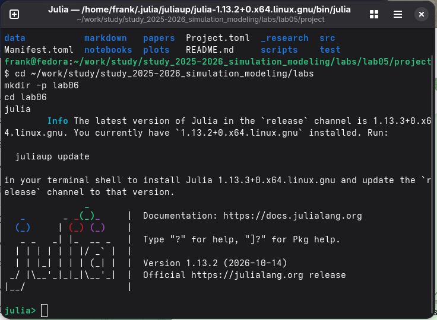{width=75% fig-pos="H"}

\newpage

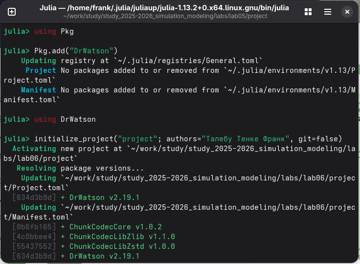{width=75% fig-pos="H"}

\newpage

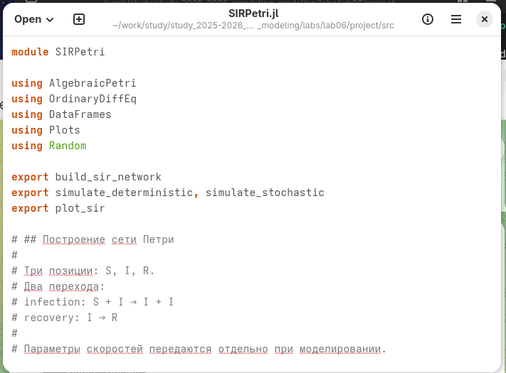{width=75% fig-pos="H"}

\newpage
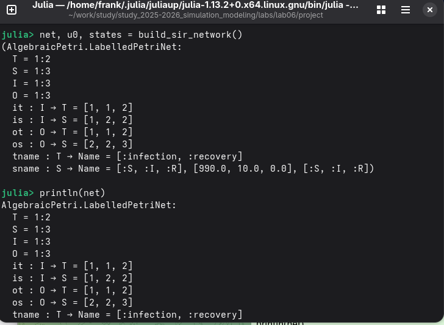{width=75% fig-pos="H"}

\newpage
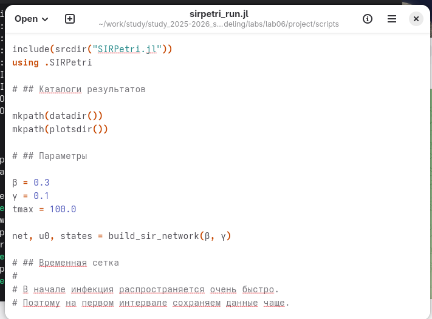{width=75% fig-pos="H"}

\newpage
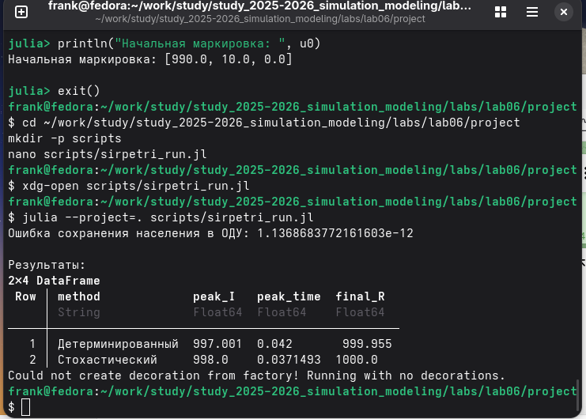{width=75% fig-pos="H"}

\newpage
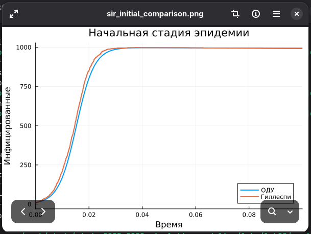{width=75% fig-pos="H"}

\newpage
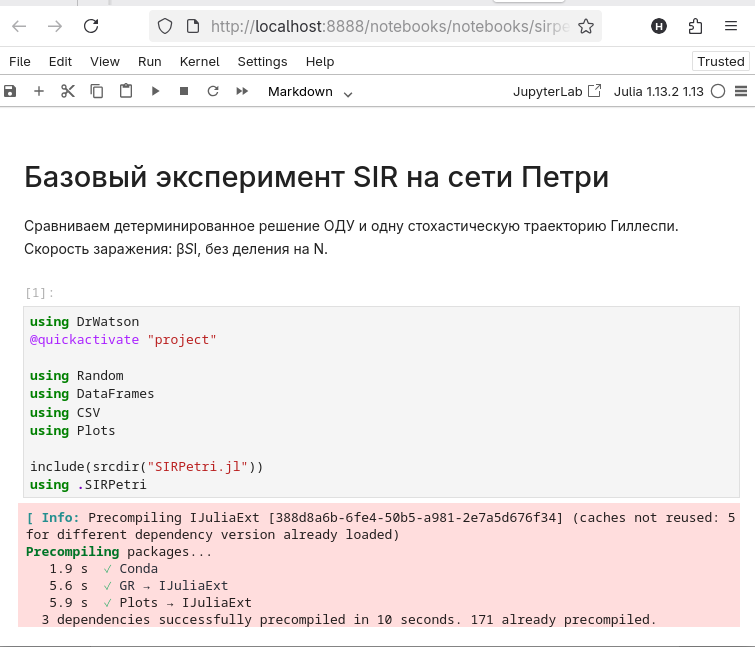{width=75% fig-pos="H"}

\newpage
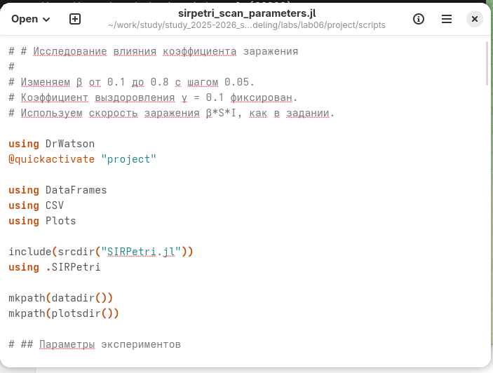{width=75% fig-pos="H"}

\newpage
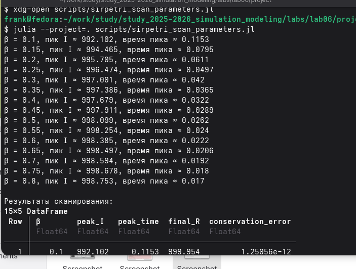{width=75% fig-pos="H"}

\newpage
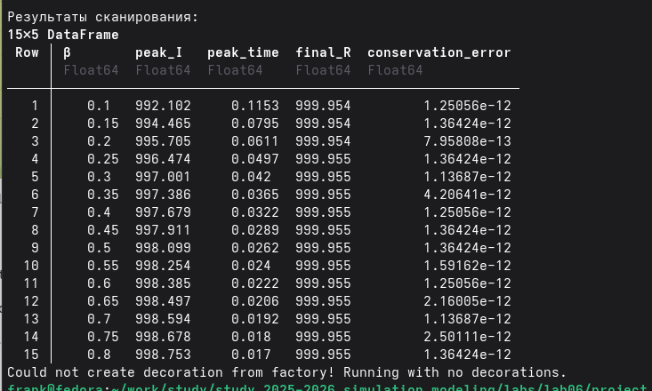{width=75% fig-pos="H"}

\newpage
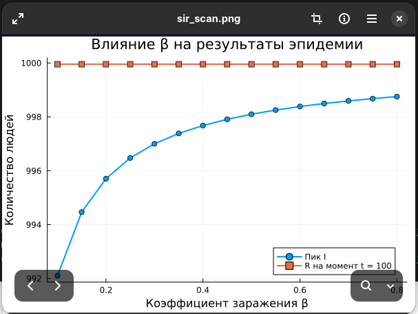{width=75% fig-pos="H"}

\newpage
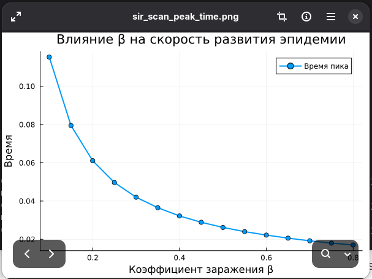{width=75% fig-pos="H"}

\newpage
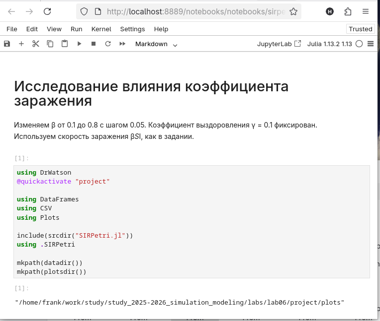{width=75% fig-pos="H"}

\newpage
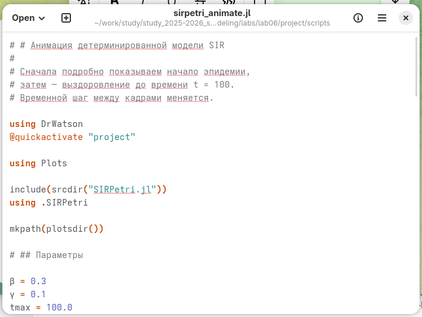{width=75% fig-pos="H"}

\newpage
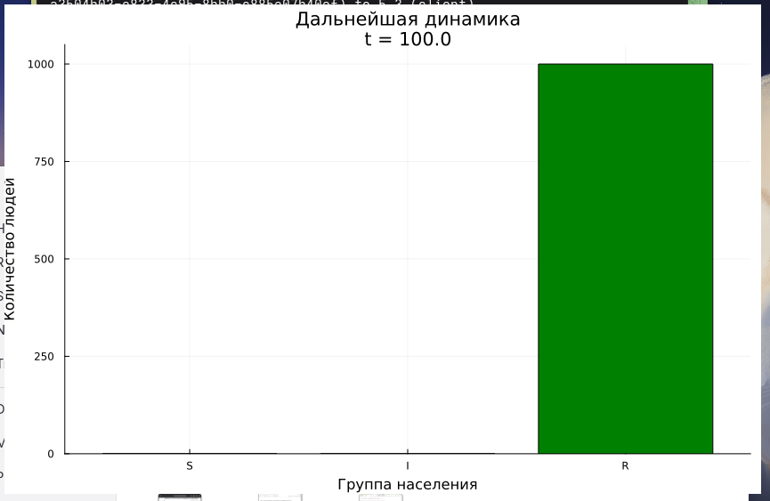{width=75% fig-pos="H"}

\newpage
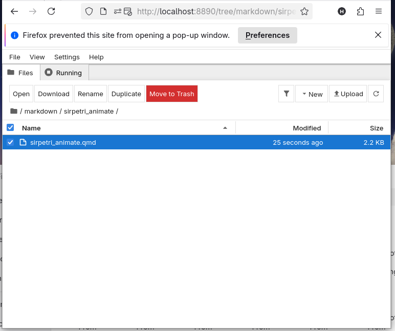{width=75% fig-pos="H"}

\newpage
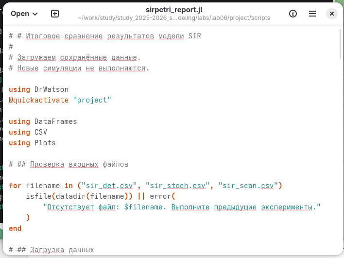{width=75% fig-pos="H"}
\newpage
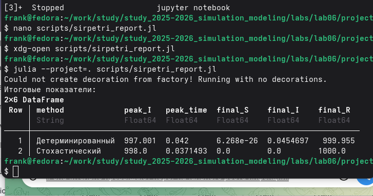{width=75% fig-pos="H"}
\newpage
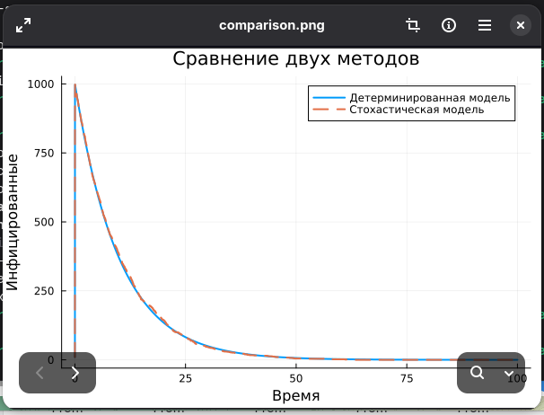{width=75% fig-pos="H"}

\newpage
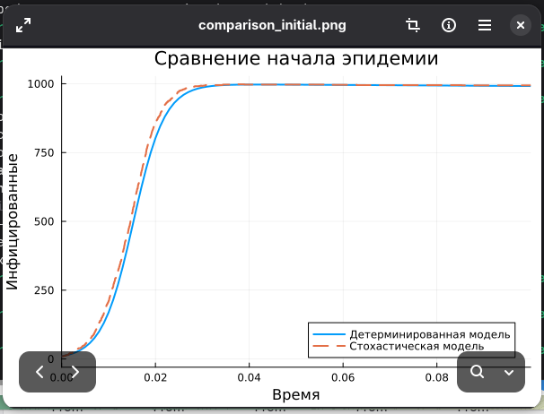{width=75% fig-pos="H"}

\newpage
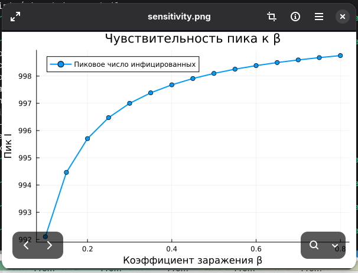{width=75% fig-pos="H"}

\newpage
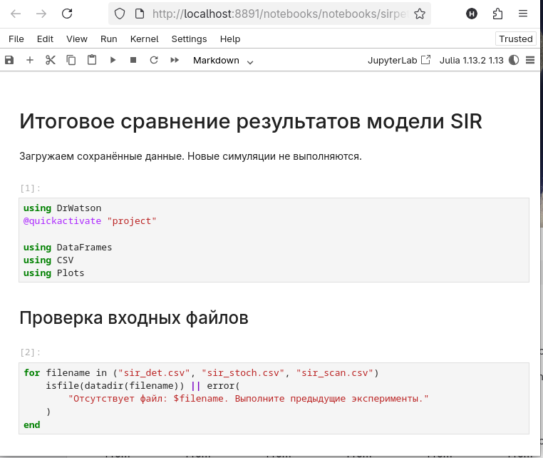{width=75% fig-pos="H"}

\newpage

# Результаты

Реализована модель SIR на основе сетей Петри. Проведён базовый прогон, получены детерминированные и стохастические результаты, выполнено исследование коэффициента заражения и подготовлены сравнительные визуализации.

\newpage

# Обсуждение результатов

Детерминированная модель позволяет рассмотреть усреднённую динамику эпидемии. Стохастическая модель демонстрирует возможные отклонения, связанные со случайным характером заражений и выздоровлений. Изменение коэффициента заражения позволяет оценить чувствительность результатов к параметрам модели.

\newpage

# Заключение

В ходе лабораторной работы № 6 реализована и исследована модель SIR с использованием аппарата сетей Петри в Julia. Выполнены базовые и параметрические эксперименты, а результаты представлены в виде таблиц и графиков.

\newpage

# Список литературы {.unnumbered}

1. Материалы лабораторной работы № 6 «Реализация основных моделей в подходе сетей Петри» (предоставленный отчёт).
2. [Материалы лабораторной работы на платформе РУДН](https://esystem.rudn.ru/pluginfile.php/3145800/mod_resource/content/1/lab06.pdf).

