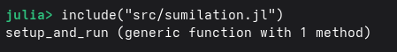
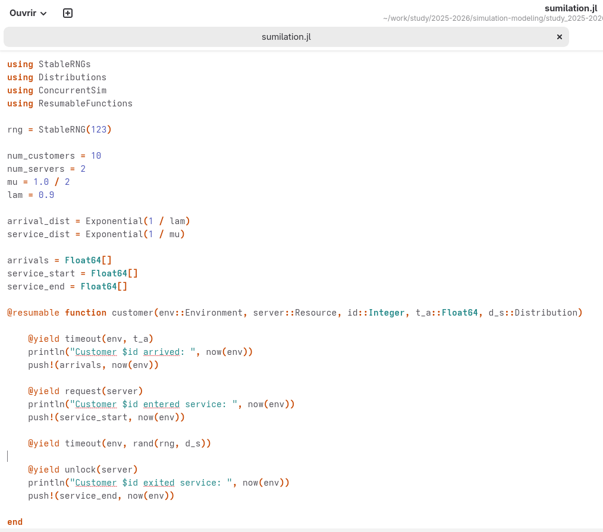
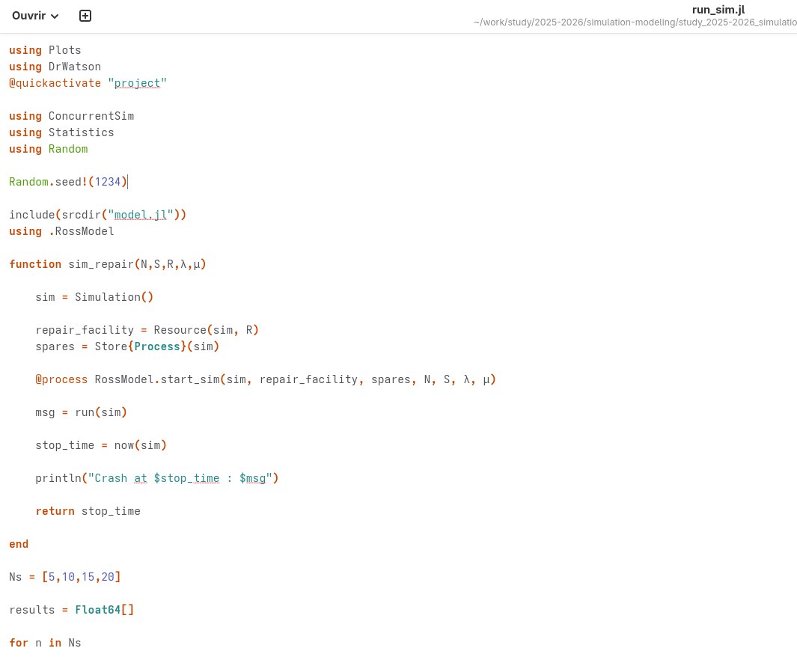
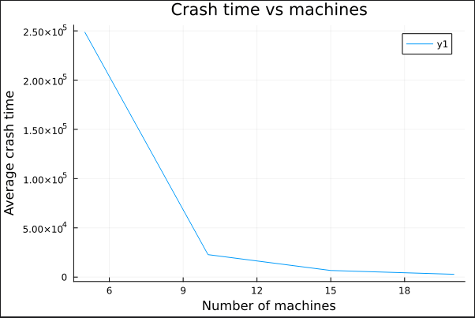

---
## Author
author:
  name: Талебу Тенке Франк
## Title
title: Лабораторная работа № 7
subtitle: "Дискретно-событийное моделирование: M/M/c и модель Росса"
date: today
date-format: "YYYY-MM-DD"
---

# Информация

## Докладчик

- **Талебу Тенке Франк**
- **Студенческий билет:** 1032224534
- Российский университет дружбы народов имени Патриса Лумумбы
- Дисциплина: Имитационное моделирование
- Лабораторная работа № 7

::: notes
Представиться и назвать тему: дискретно-событийное моделирование систем обслуживания и ремонта машин.
:::

# Вводная часть

## Актуальность

- Дискретно-событийное моделирование описывает систему через последовательность событий.
- Системы массового обслуживания позволяют изучать очереди и загрузку ресурсов.
- Модели ремонта помогают исследовать надёжность работы оборудования.

::: notes
Объяснить, что событиями могут быть приход клиента, завершение обслуживания или поломка машины.
:::

## Объект и предмет исследования

- **Объект:** системы массового обслуживания и ремонта машин.
- **Предмет:** время ожидания, загрузка обслуживающих каналов, резервные машины и динамика отказов.

::: notes
Назвать две исследуемые модели: M/M/c и модель Росса.
:::

## Цели и задачи

**Цель:** изучить методы дискретно-событийного моделирования и применить их к системам обслуживания и ремонта.

- Реализовать модель M/M/c в структуре DrWatson и построить графики.
- Реализовать модель Росса с несколькими ремонтниками.
- Исследовать разные количества машин.
- Оценить загрузку ремонтников, очередь и число исправных машин.
- Сопоставить результаты с аналитическим решением.

::: notes
Перечислить задания лабораторной работы, отдельно выделив две модели.
:::

## Материалы и методы

- **Julia:** реализация программ моделирования.
- **DrWatson:** организация структуры проекта.
- **M/M/c:** поток заявок и несколько параллельных каналов обслуживания.
- **Модель Росса:** отказы, резервные машины и ремонтные ресурсы.
- **Графики:** анализ результатов моделирования.

::: notes
Пояснить, что обе модели изучаются методом дискретных событий.
:::

# Ход выполнения работы

## Теоретическая модель M/M/c

- Первая буква **M** означает пуассоновский поток заявок.
- Вторая **M** означает экспоненциальное время обслуживания.
- **c** — число параллельных каналов обслуживания.
- Основные параметры: интенсивность поступления λ и обслуживания μ.

::: notes
Объяснить обозначение M/M/c и смысл параметров λ, μ и c.
:::

## Реализация M/M/c

- Создан скрипт `src/sumilation.jl` согласно исходной презентации.
- Модель формирует события прибытия клиентов и начала обслуживания.
- Используются объекты `Simulation()` и `Resource()`.

{width=70%}

::: notes
Показать фрагмент кода и объяснить создание симуляции и обслуживающего ресурса.
:::

## Запуск модели M/M/c

- Подготовлен сценарий `scripts/run.jl`.
- После запуска получены данные о событиях и вывод в консоль.

{width=70%}

::: notes
Объяснить, как запускается эксперимент и где просматриваются результаты.
:::

## Результаты модели M/M/c

- Результаты представлены в виде графиков.
- Графики помогают оценивать поведение очереди и системы обслуживания.

{width=70%}

::: notes
Показать первый график и объяснить, что он иллюстрирует в эксперименте.
:::

## Дополнительная визуализация M/M/c

- Построен второй график для анализа работы модели.
- Сравнение визуализаций помогает оценить характеристики обслуживания.

{width=70%}

::: notes
Показать второй график и сопоставить его с предыдущим.
:::

## Теоретическая модель Росса

- В системе работают **N** машин, а **S** машин находятся в резерве.
- При поломке резервная машина заменяет отказавшую, если резерв доступен.
- Сломанная машина направляется на ремонт.
- При отсутствии резерва возникает отказ системы (*crash*).

::: notes
Объяснить назначение резервных машин и условие завершения моделирования.
:::

## Реализация модели Росса

- Подготовлен файл `src/model.jl`.
- В модели создаются работающие и резервные машины.
- Ремонт выполняется через соответствующий ресурс модели.

{width=70%}

::: notes
Показать код модели Росса и объяснить создание работающих и резервных машин.
:::

## Запуск модели Росса

- Создан сценарий `scripts/run_sum.jl`.
- Модель запускается для исследования поведения системы ремонта.

{width=70%}

::: notes
Показать сценарий запуска модели Росса.
:::

## Вывод результатов модели Росса

- После запуска получен вывод в консоль.
- Результаты используются для оценки работы системы ремонта.

{width=70%}

::: notes
Показать консольные результаты и объяснить их назначение.
:::

## График модели Росса

- Построен график результатов имитационного эксперимента.
- Он позволяет анализировать изменение состояния системы во времени.

{width=70%}

::: notes
Показать график модели Росса и объяснить его связь с работой и отказами машин.
:::

# Результаты и обсуждение

## Основные результаты

- Рассмотрены модели **M/M/c** и **Росса**.
- Реализованы сценарии запуска на Julia.
- Получены консольные результаты и графики обеих моделей.
- Изучены особенности систем с очередями и резервными машинами.

::: notes
Кратко перечислить выполненные части лабораторной работы. Не утверждать, что аналитическое сравнение выполнено, если оно не представлено в отчёте.
:::

# Заключение

## Выводы

- Дискретно-событийный подход подходит для анализа очередей и отказов оборудования.
- Модель M/M/c описывает обслуживание заявок несколькими каналами.
- Модель Росса описывает систему машин, резерва и ремонта.
- Графики помогают исследовать динамику работы моделируемых систем.

::: notes
Сформулировать главный вывод: модели позволяют анализировать поведение сложных систем через события.
:::

## Спасибо за внимание!

::: notes
Поблагодарить аудиторию и предложить задать вопросы.
:::
