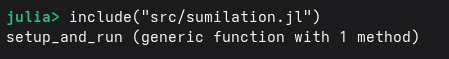
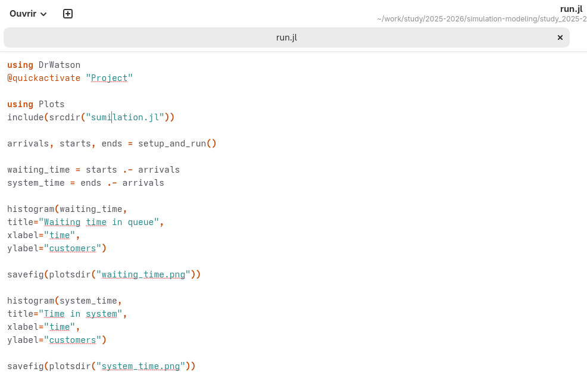

--- 
## Front matter 
title: "Лабораторная работа №7" 
subtitle: "Дискретно-событийное моделирование" 
author: "Талебу Тенке" 
 
## Generic otions 
lang: ru-RU 
toc-title: "Содержание" 
 
## Bibliography 
bibliography: bib/cite.bib 
csl: pandoc/csl/gost-r-7-0-5-2008-numeric.csl 
 
## Pdf output format 
toc: true # Table of contents 
toc-depth: 2 
lof: true # List of figures 
lot: true # List of tables 
fontsize: 12pt 
linestretch: 1.5 
papersize: a4 
documentclass: scrreprt 
 
## I18n polyglossia 
polyglossia-lang: 
  name: russian 
  options: 
    - spelling=modern 
    - babelshorthands=true 
polyglossia-otherlangs: 
  name: english 
 
## I18n babel 
babel-lang: russian 
babel-otherlangs: english 
 
## Fonts 
mainfont: PT Serif 
romanfont: PT Serif 
sansfont: PT Sans 
monofont: PT Mono 
mainfontoptions: Ligatures=TeX 
romanfontoptions: Ligatures=TeX 
sansfontoptions: Ligatures=TeX,Scale=MatchLowercase 
monofontoptions: Scale=MatchLowercase,Scale=0.9 
 
## Biblatex 
biblatex: true 
biblio-style: "gost-numeric" 
biblatexoptions: 
  - parentracker=true 
  - backend=biber 
  - hyperref=auto 
  - language=auto 
  - autolang=other* 
  - citestyle=gost-numeric 
 
## Pandoc-crossref LaTeX customization 
figureTitle: "Рис." 
tableTitle: "Таблица" 
listingTitle: "Листинг" 
lofTitle: "Список иллюстраций" 
lotTitle: "Список таблиц" 
lolTitle: "Листинги" 
 
## Misc options 
indent: true 
header-includes: 
  - \usepackage{indentfirst} 
  - \usepackage{float} # keep figures where there are in the text 
  - \floatplacement{figure}{H} # keep figures where there are in the text 
--- 
 
# Цель работы 
 
- изучить методы дискретно-событийного моделирования и применить их для анализа работы системы ремонта машин с ограниченным количеством запасных частей и ремонтников.
 
# Задание 
 
## Модель M/M/c 
 
1. Переведите в структуру DrWatson.
2. Добавьте необходимые графики.
 
## Модель Росса 
 
1. Переведите в структуру DrWatson.
2. Добавьте нескольких ремонтников.
3. Сделайте прогон для разного количества машин.
4. Проведите мониторинг загрузки ремонтника, средней длины очереди на ремонт.
5. Построение графиков изменения числа исправных машин во времени.
6. Сравните с аналитическим решением.
 
# Теоретическое введение 
 
## Модель M/M/c 
 
Модель M/M/c (по классификации Кендалла) — это система массового обслуживания со следующими свойствами:
 
- M (Markovian) — входящий поток заявок пуассоновский, интервалы между прибытиями распределены экспоненциально с параметром.
- M — время обслуживания каждой заявки распределено экспоненциально с параметром.
- c — количество идентичных обслуживающих приборов (каналов), работающих параллельно.
 
## Модель Росса 
 
Модель представляет собой классический пример системы массового обслуживания с конечной популяцией, резервом и ремонтом.
 
### Формальная постановка задачи 
 
- В системе находятся идентичных машин, которые постоянно работают и могут выходить из строя.
- Машин находятся в резерве и готовы немедленно заменить любую отказавшую.
- Одно ремонтное устройство (ремонтник), которое может одновременно ремонтировать только одну машину.
- Когда работающая машина ломается, происходит следующее:
 
1. Немедленно берётся одна резервная машина (если она есть) и запускается в работу вместо сломавшейся.
2. Сломанная машина отправляется в ремонт.
3. Если резерва нет, система падает (crash). Моделирование заканчивается.
 
- После ремонта машина пополняет пул резервных (становится исправной и ждёт).
 
# Выполнение лабораторной работы 
 
## Модель M/M/c 
 
Сначала я создала файл `src/sumilation.jl` и написала код и запустила его (рис. [-@fig:001]).
 
{#fig:001 width=100%}
 
Код (рис. [-@fig:002]).
 
{#fig:002 width=100%}
 
```julia
function setup_and_run()

    sim = Simulation()
    server = Resource(sim, num_servers)

    arrival_time = 0.0

    for i in 1:num_customers
        arrival_time += rand(rng, arrival_dist)
        @process customer(sim, server, i, arrival_time, service_dist)
    end

    run(sim)

    return arrivals, service_start, service_end

end