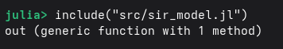
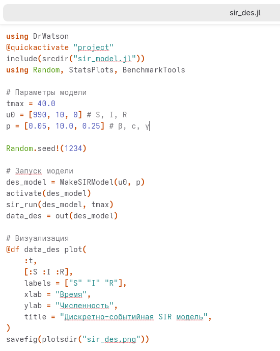
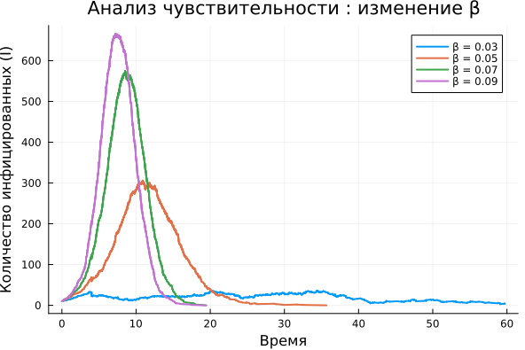
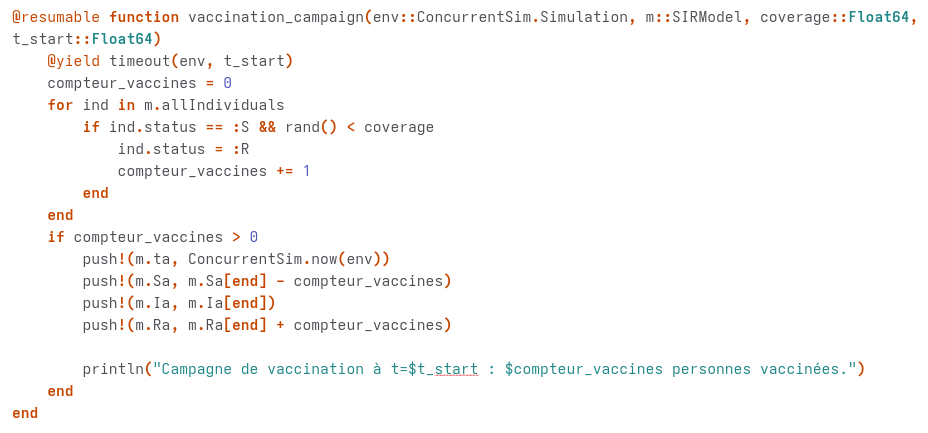
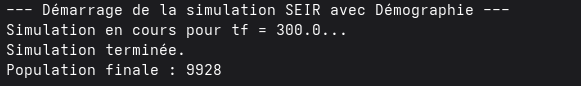

---
## Author
author:
  name: Талебу Тенке Франк
## Title
title: "Лабораторная работа № 8"
subtitle: "Реализация основных моделей в дискретно-событийном подходе"
date: today
date-format: "YYYY-MM-DD"
---

# Информация

## Докладчик

- **Талебу Тенке Франк**
- **Студенческий билет:** 1032224534
- Российский университет дружбы народов имени Патриса Лумумбы
- Дисциплина: Имитационное моделирование
- Лабораторная работа № 8

::: notes
Представиться и назвать тему: дискретно-событийная модель распространения инфекции.
:::

# Вводная часть

## Актуальность

- Распространение инфекции зависит от отдельных случайных событий.
- Дискретно-событийный подход позволяет моделировать заражение и выздоровление.
- Сравнение сценариев помогает исследовать влияние параметров эпидемии.

::: notes
Объяснить, что в модели время продвигается от одного события к следующему.
:::

## Объект и предмет исследования

- **Объект:** распространение инфекционного заболевания в популяции.
- **Предмет:** дискретно-событийная реализация моделей SIR и SEIR на Julia.

::: notes
Уточнить, что исследуются переходы людей между эпидемиологическими состояниями.
:::

## Цели и задачи

**Цель:** реализовать и исследовать дискретно-событийную модель SIR.

- Создать ядро модели и скрипт запуска.
- Получить динамику состояний S, I и R.
- Проверить чувствительность к параметрам.
- Рассмотреть длительность болезни, производительность, вакцинацию и SEIR.

::: notes
Кратко перечислить этапы лабораторной работы.
:::

## Материалы и методы

- **Julia:** реализация модели и запуск симуляций.
- **Дискретно-событийное моделирование:** обработка заражений и выздоровлений.
- **DataFrame и CSV:** хранение результатов.
- **BenchmarkTools:** оценка производительности.
- **Quarto:** оформление результатов.

::: notes
Назвать назначение инструментов и отметить, что результаты сохраняются для анализа.
:::

# Ход выполнения работы

## Структура программного комплекса

- `src/sir_model.jl` содержит структуры данных и логику событий.
- `scripts/sir_des.jl` задаёт параметры, запускает модель и строит графики.
- Начальное состояние задаётся числами восприимчивых, инфицированных и выздоровевших.

{width=70%}

::: notes
Показать структуру кода и объяснить назначение двух основных файлов.
:::

## Запуск модели SIR

- Модель использует параметры передачи инфекции, контактов и выздоровления.
- Результаты содержат время и численности групп S, I, R.
- Скрипт запуска формирует временные ряды.

{width=70%}

::: notes
Показать скрипт запуска и пояснить основные входные параметры.
:::

## Базовый график SIR

- На графике отображаются изменения S(t), I(t), R(t).
- Кривые позволяют наблюдать развитие эпидемического процесса.

{width=70%}

::: notes
Пояснить смысл трёх кривых, не называя численных значений, которых нет в исходном материале.
:::

## Анализ чувствительности

- Выполнено варьирование параметров модели.
- Для каждого сценария предусмотрено сохранение результатов.
- Сравнение графиков показывает зависимость динамики от параметров.

{width=70%}

::: notes
Объяснить, зачем повторять расчёт с разными значениями параметров.
:::

## Дополнительные эксперименты

- Исследована замена случайной длительности болезни на фиксированную.
- Для измерения времени выполнения применяется `BenchmarkTools`.
- Рассмотрено добавление события вакцинации по таймеру.

{width=70%}

::: notes
Пояснить разницу между случайным и фиксированным временем болезни и назначение измерения производительности.
:::

# Результаты

## Вакцинация

- В модель добавляется событие вакцинации.
- Вакцинация изменяет переходы между состояниями популяции.
- Такой сценарий позволяет исследовать влияние вмешательства.

{width=70%}

::: notes
Показать реализацию события вакцинации и объяснить его смысл.
:::

## Расширение модели до SEIR

- Добавлено промежуточное состояние **E** — латентный период.
- После заражения человек сначала переходит в E, затем в I.
- SEIR позволяет учитывать задержку между заражением и инфекционностью.

{width=70%}

::: notes
Объяснить отличие SEIR от SIR: наличие отдельной стадии E.
:::

## Итоговая визуализация

- Получен график расширенной модели.
- Результаты позволяют сопоставлять сценарии SIR и SEIR.
- Подготовлены материалы для отчёта и дальнейшего анализа.

{width=70%}

::: notes
Показать итоговый график и кратко описать, что сравнивается.
:::

# Заключение

## Главный вывод

- Реализован программный комплекс дискретно-событийной модели SIR на Julia.
- Проведён анализ влияния параметров и рассмотрены дополнительные сценарии.
- Изучены оценка производительности, вакцинация и расширение до SEIR.
- Результаты оформлены для представления и анализа.

::: notes
Подвести итог лабораторной работы и подчеркнуть преимущества событийного подхода.
:::
