**Студент:** Талебу Тенке Франк  
**Студенческий номер:** 1032224534  
**Лабораторная работа № 8:** Реализация основных моделей в дискретно-событийном подходе

\newpage

# Введение

Работа посвящена реализации модели распространения инфекции SIR с использованием дискретно-событийного моделирования на языке Julia.

\newpage

## Актуальность

Дискретно-событийный подход позволяет моделировать отдельные события заражения и выздоровления и исследовать влияние случайности и параметров на динамику эпидемии.

\newpage

## Цель работы

Изучить дискретно-событийный подход на примере модели SIR, реализовать стохастическую модель в Julia, проанализировать влияние параметров и рассмотреть расширение до SEIR.

\newpage

## Задачи

1. Подготовить программный комплекс из `src/sir_model.jl` и `scripts/sir_des.jl`.
2. Выполнить моделирование и построить графики.
3. Исследовать чувствительность к параметрам.
4. Рассмотреть детерминированную длительность болезни.
5. Оценить производительность.
6. Добавить вакцинацию и исследовать модель SEIR.

\newpage

# Теоретическая часть

В модели SIR популяция делится на восприимчивых (S), инфицированных (I) и выздоровевших (R). В дискретно-событийной реализации изменения состояний происходят в моменты событий заражения и выздоровления.

Программный комплекс состоит из ядра `src/sir_model.jl` и скрипта запуска `scripts/sir_des.jl`. Входные данные: начальные численности групп, параметры передачи и выздоровления, длительность моделирования и, при необходимости, зерно генератора случайных чисел. Выходные данные: таблица `DataFrame` и график `plots/sir_des.png`.

Модель SEIR дополнительно вводит латентное состояние E между заражением и инфекционностью.

\newpage

# Материалы и методы

Использованы язык Julia, дискретно-событийное моделирование, таблицы `DataFrame`, построение графиков, а также `BenchmarkTools` для оценки производительности. Выполненные этапы представлены на снимках экрана.

\newpage

# Выполнение лабораторной работы

Работа включает создание программы, базовый запуск и дополнительные эксперименты.


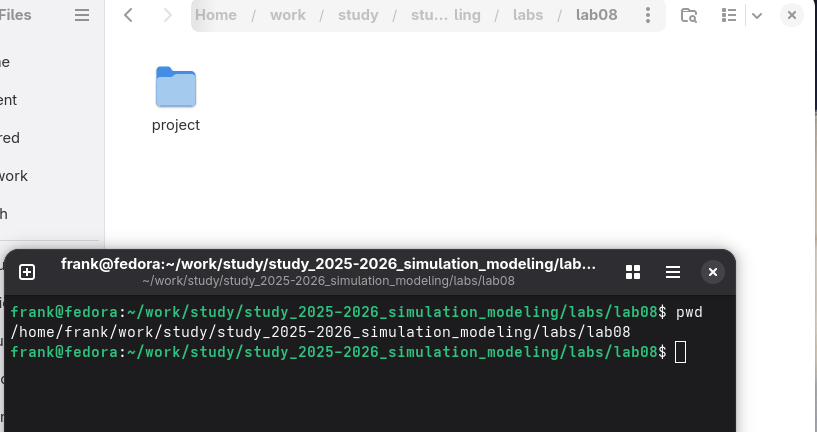{width=75% fig-pos="H"}
\newpage

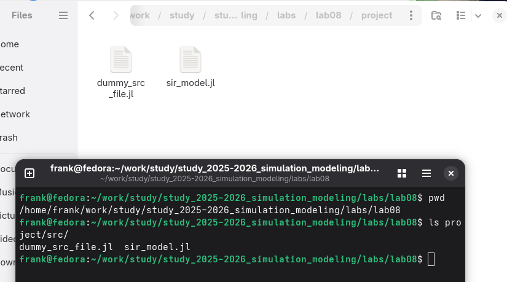{width=75% fig-pos="H"}

\newpage

\newpage

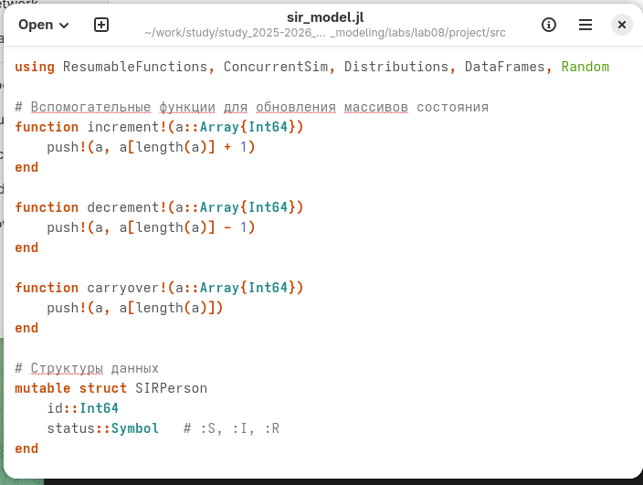{width=75% fig-pos="H"}
\newpage

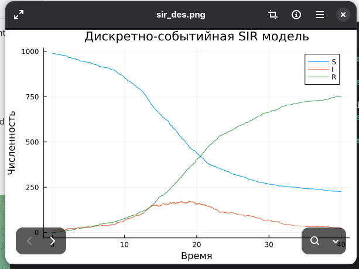{width=75% fig-pos="H"}

\newpage

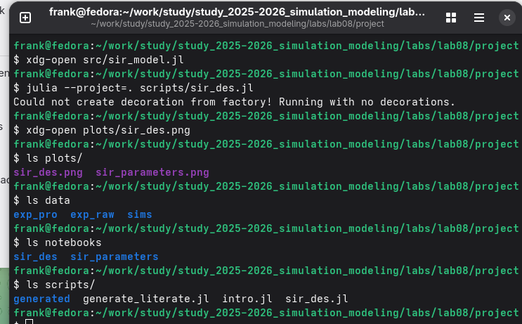{width=75% fig-pos="H"}

\newpage
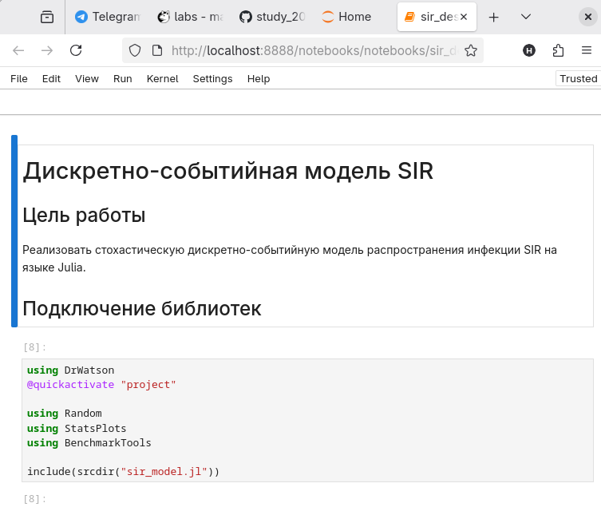{width=75% fig-pos="H"}

\newpage

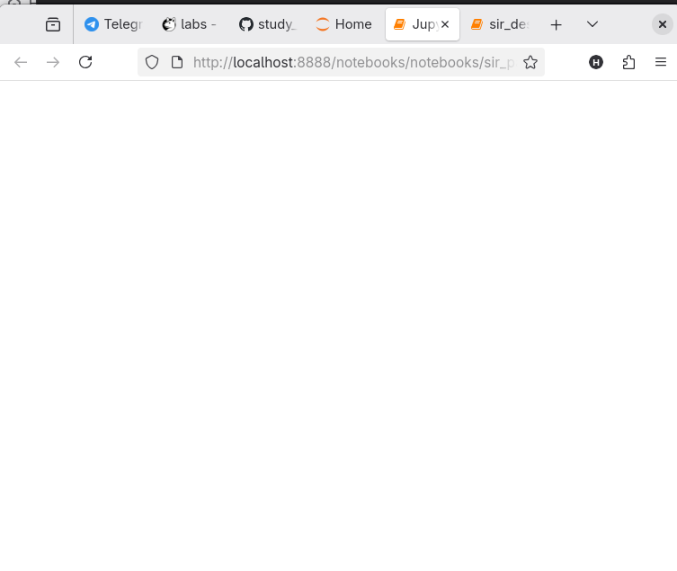{width=75% fig-pos="H"}

\newpage

```julia
# Исходный вариант
@yield timeout(env, rand(Exponential(1/m.γ)))

# Изменённый вариант
@yield timeout(env, 1/m.γ)
```

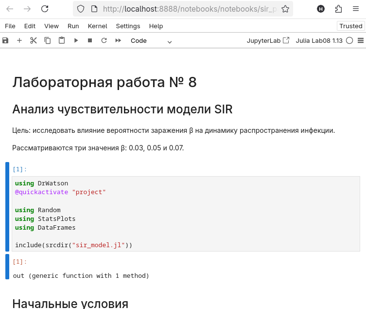{width=75% fig-pos="H"}
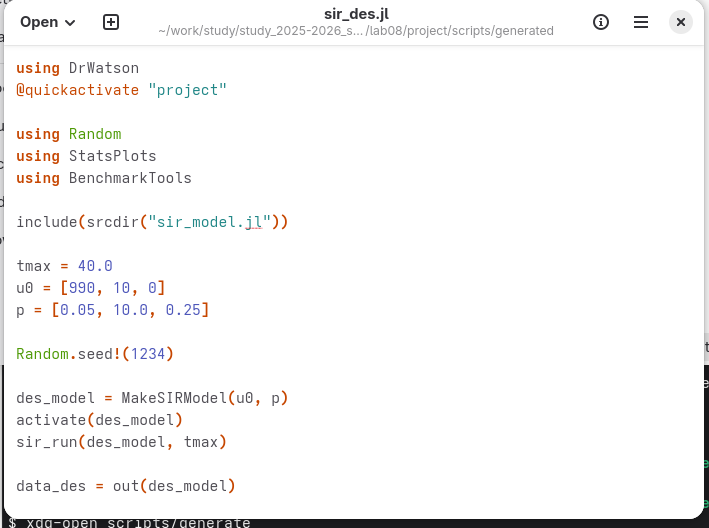{width=75% fig-pos="H"}

\newpage
```

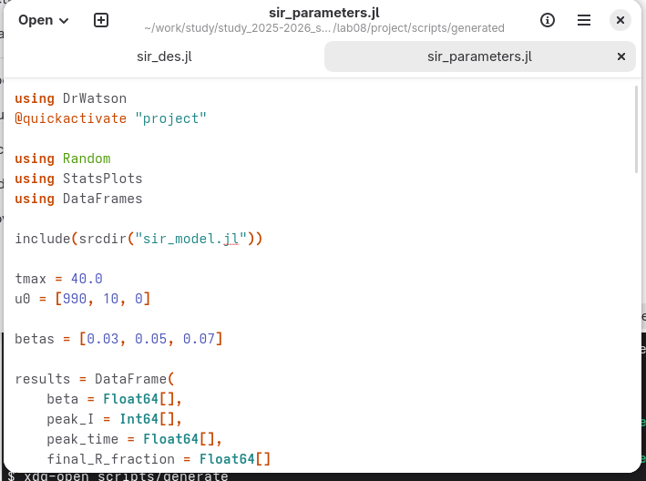{width=75% fig-pos="H"}

\newpage

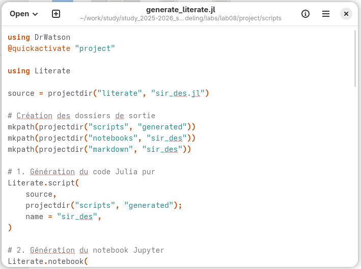{width=75% fig-pos="H"}

\newpage

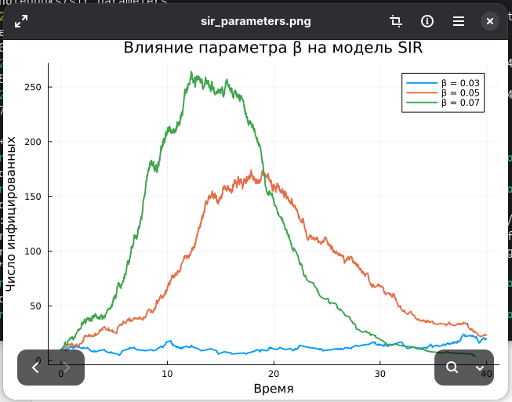{width=75% fig-pos="H"}
\newpage

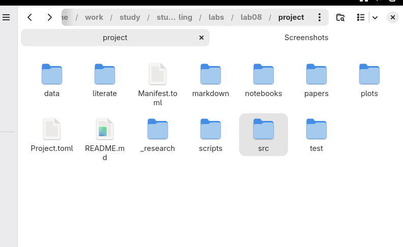{width=75% fig-pos="H"}

\newpage

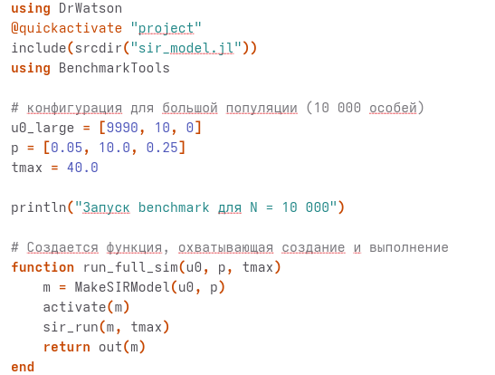{width=75% fig-pos="H"}

\newpage

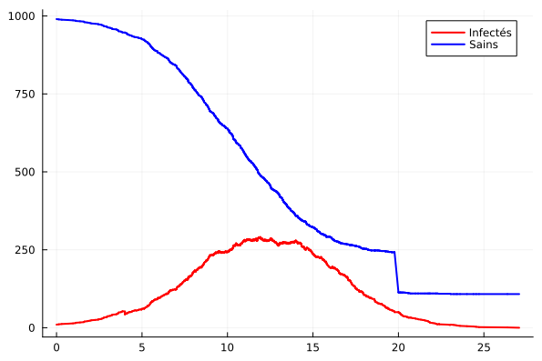{width=75% fig-pos="H"}

\newpage

# Результаты

Выполнен запуск дискретно-событийной модели SIR, построены графики, проведены эксперименты с параметрами, фиксированной длительностью болезни и вакцинацией. Также рассмотрена модель SEIR. Количественные результаты приведены на соответствующих снимках экрана.

\newpage

# Обсуждение результатов

Изменение параметров позволяет исследовать чувствительность динамики эпидемии. Замена случайной длительности болезни фиксированной изменяет механизм моделирования выздоровления. Вакцинация и введение латентного состояния E расширяют базовую модель SIR. Без исходных численных таблиц точные количественные сравнения не приводятся.

\newpage

# Заключение

Реализована модель SIR в дискретно-событийном подходе на языке Julia, рассмотрены дополнительные эксперименты и расширение модели до SEIR.

\newpage

# Список литературы {.unnumbered}

1. Материалы лабораторной работы № 8 «Реализация основных моделей в дискретно-событийном подходе» (предоставленный отчёт).
